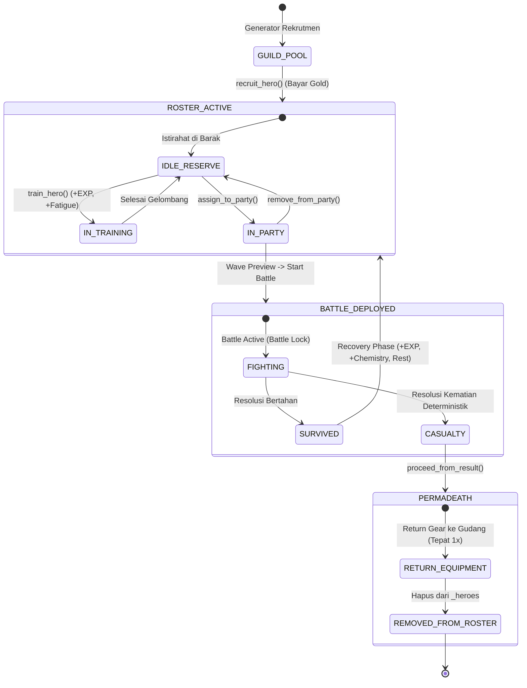

# Phase 4 — Hero System Technical Plan & Architecture Specification

## Project Context
- **Project:** `fortress_game`
- **Repository:** `https://github.com/AchmadKing/fortress_game.git`
- **Branch:** `main`
- **Current Phase:** Phase 4 — Hero System
- **Current Status:** AUTHORIZED / PLANNING
- **Previous Phases:** Phase 0–3 COMPLETED & OFFICIALLY CLOSED (Commit `e6c0c97`)

---

## A. Phase Objective

Phase 4 bertujuan membangun **Hero System (Sistem Pahlawan & Komandan)** yang utuh, mendalam, dan modular, memperluas fondasi hero minimal yang telah divalidasi pada Phase 1, Phase 2, dan Phase 3C/3D.

Sistem pahlawan dirancang dengan kedalaman *character-management strategy RPG* yang berfokus pada:
1. Identitas dan perkembangan individual setiap pahlawan (level, EXP, stat, bintang saat ini vs potensi).
2. Peran (*Hero Role*) dan sinergi perlengkapan yang terintegrasi dengan gudang bersama (*Shared Fortress Warehouse*).
3. Pengelolaan stamina, kelelahan (*fatigue*), dan moral (*morale*).
4. Fasilitas pelatihan (*Training Facility*) dan sistem rekrutmen pahlawan (*Mercenary Guild*).
5. Pembentukan regu pahlawan (*Party System*) dan penguatan hubungan kemitraan tempur (*Hero Chemistry*).
6. Fondasi bakat dan kemampuan (*Skills & Talent Foundation*).
7. Konsekuensi kematian permanen (*Permadeath*) yang deterministik dengan jaminan konservasi kepemilikan perlengkapan.

> [!IMPORTANT]
> **Prinsip Utama: EXTEND, DON'T BREAK**
> Phase 4 BUKAN penulisan ulang (*rewrite*). DILARANG membuat `HeroModelV2`, dilarang membuat gudang inventaris kedua khusus hero, dan dilarang mengganti kontrak domain Phase 1–3 yang sudah tervalidasi. Seluruh penambahan dilakukan secara aditif di atas arsitektur yang sudah ada.

---

## B. Existing Hero Foundation Audit

Hasil audit menyeluruh terhadap repositori pada commit `e6c0c97`:

### 1. Model Domain Existing (`scripts/domain/model/hero_model.gd`)
`HeroModel` mewarisi `RefCounted` dengan implementasi aktif saat ini:
- **Identitas & Tingkat:** `hero_id: String`, `hero_name: String`, `level: int = 1`, `current_exp: int = 0`.
- **Sistem Bintang:** `current_star: int = 1`, `potential_star: int = 3`.
- **Stat Dasar:** `base_hp: int = 250`, `base_atk: int = 35`, `base_def: int = 20`.
- **Kondisi:** `fatigue: int = 0` (0–100), `morale: int = 100` (0–150), `is_alive: bool = true`.
- **Kemitraan:** `chemistry_map: Dictionary` (`partner_id -> points`).
- **Slot Perlengkapan (Phase 3C):**
  - `primary_equipment: RefCounted` (`SWORD`, `SPEAR`, `BOW`)
  - `secondary_equipment: RefCounted` (`SHIELD`)
  - `armor_equipment: RefCounted` (`HEAVY_ARMOR`)
  - Metode: `equip()`, `unequip()`, `has_equipment()`, `get_equipment()`, `get_equipped_items()`, `clear_equipment()`.
- **Formula Matematika Aktif:**
  - EXP Dibutuhkan: $\text{ReqEXP}(L) = \lfloor 120.0 \times L^{1.55} \rfloor$.
  - Multiplier Kelelahan: $\text{Mult}_{\text{fatigue}} = \max(0.40, 1.0 - \frac{\text{fatigue} - 20}{80} \times 0.60)$ jika $\text{fatigue} > 20$.
  - Skalasi ATK Efektif: $\text{Effective ATK} = \lfloor \text{base\_atk} \times (1 + (L-1) \times 0.12) \times (1 + (\text{star}-1) \times 0.20) \times \text{chem\_bonus} \times \text{fat\_mult} \times \text{gear\_mult} \rfloor$.
  - Skalasi DEF Efektif: $\text{Effective DEF} = \lfloor \text{base\_def} \times (1 + (L-1) \times 0.10) \times (1 + (\text{star}-1) \times 0.20) \times \text{fat\_mult} \times \text{gear\_def} \rfloor$.
  - Bonus Chemistry: $1.0 + (\text{Total Chemistry Points} \times 0.005)$.

### 2. Koordinasi Aplikasi Existing (`scripts/application/coordinators/game_coordinator.gd`)
- Memiliki koleksi pahlawan: `_heroes: Array` (default awal: `hero_alder` dan `hero_lyra`).
- Integrasi slot perlengkapan dengan gudang senjata bersama benteng: `equip_hero()`, `unequip_hero()`, `swap_hero_equipment()`.
- Proteksi Battle Lock: mutasi perlengkapan hero dilarang keras saat state `BATTLE`.
- Pengembalian perlengkapan hero permadeath tepat 1 kali pada fase `proceed_from_result()`.
- Pemulihan kelelahan otomatis saat istirahat pasca-tempur (`hero.rest(20)` jika `fatigue >= 30`).
- Serialisasi snapshot ke `GameStateSnapshot.heroes_data`.

### 3. Simulasi Pertempuran Existing (`scripts/simulation/combat_engine.gd`)
- Menghitung kontribusi ATK hero hidup ke fase pertempuran jarak dekat (*melee engagement*).
- Menambah kelelahan pertempuran: `hero.add_fatigue(15)`.
- Menambah chemistry pahlawan yang bertarung bersama di party: `+2` poin per pertempuran.
- Menghitung evaluasi permadeath deterministik berbasis rasio jebolan benteng, pertahanan hero, dan penalti kelelahan.
- Membagikan perolehan EXP pertempuran secara merata ke seluruh pahlawan hidup.

### 4. Baseline Pengujian Existing
- 134 unit & integration test passing 100% (termasuk 22 test khusus Phase 3C dan 15 test Phase 3E).
- 1 Scene Smoke Playtest passing 100% tanpa error.

---

## C. Architecture Boundary

Mengikuti aturan batas arsitektur Phase 1:

```
┌─────────────────────────────────────────────────────────────┐
│                     PRESENTATION LAYER                      │
│   (GameController, PrototypeDebugView, HeroManagementView)  │
│      - Hanya menampilkan data snapshot                      │
│      - Menangkap input aksi pemain (Train, Rest, Assign)    │
│      - Bebas kalkulasi gameplay / rumus stat                │
└──────────────────────────────▲──────────────────────────────┘
                               │ (Commands & Signals)
┌──────────────────────────────┴──────────────────────────────┐
│                     APPLICATION LAYER                       │
│                     (GameCoordinator)                       │
│      - Mengorkestrasi siklus hidup Hero                     │
│      - Mengelola Roster Pahlawan & Formasi Party            │
│      - Menegakkan Battle Lock & State Transitions           │
│      - Mengkoordinasikan Gudang Bersama & Kas Emas Benteng  │
└──────────────────────────────▲──────────────────────────────┘
                               │ (Calls Simulation / Mutates Models)
┌──────────────────────────────┴──────────────────────────────┐
│                    DOMAIN & SIMULATION                      │
│         (HeroModel, HeroRole, PartyModel, CombatEngine)     │
│      - Single Source of Truth rumus stat & EXP              │
│      - Model data individual murni (RefCounted)             │
│      - Deterministik, bebas dependensi visual/Node          │
└─────────────────────────────────────────────────────────────┘
```

---

## D. Domain Models

### 1. Ekstensi `HeroModel` (`scripts/domain/model/hero_model.gd`)
Mempertahankan seluruh field dan API existing, menambahkan field baru secara aditif:
- `role: String = "KNIGHT"`: Peran kanonikal pahlawan (`KNIGHT`, `MAGE`, `ARCHER`, `PRIEST`).
- `party_id: String = ""`: Penugasan regu aktif (`"party_1"`, `"party_2"`, atau `""` jika cadangan/istirahat).
- `unlocked_skills: Array[String] = []`: Daftar ID skill yang telah dibuka.
- `talent_points: int = 0`: Poin bakat yang dapat dialokasikan.
- `allocated_talents: Dictionary = {}`: Pemetaan ID bakat ke tingkat alokasi.
- `training_sessions_wave: int = 0`: Pelacak sesi latihan per gelombang.

### 2. Definisi Peran Pahlawan Kanonikal (`HeroRole`)
Didefinisikan secara konstan dan data-driven:
- **`KNIGHT`**:
  - Stat Affinity: HP Tinggi, DEF Tinggi, ATK Sedang.
  - Kompatibilitas Senjata: `SWORD`, `SPEAR`.
  - Kompatibilitas Perlengkapan: Wajib `SHIELD` (Secondary) & `HEAVY_ARMOR`.
- **`MAGE`**:
  - Stat Affinity: HP Rendah, DEF Rendah, ATK Sangat Tinggi.
  - Kompatibilitas Senjata: `STAFF` (atau `SPEAR`/`BOW` dalam batas Phase 3).
  - Kompatibilitas Perlengkapan: `LIGHT_ARMOR` / `CLOTH`.
- **`ARCHER`**:
  - Stat Affinity: HP Sedang, DEF Rendah, ATK Tinggi, Ranged Priority.
  - Kompatibilitas Senjata: `BOW`.
  - Kompatibilitas Perlengkapan: `LIGHT_ARMOR`.
- **`PRIEST`**:
  - Stat Affinity: HP Sedang, DEF Sedang, Healing/Support Aura.
  - Kompatibilitas Senjata: `MACE` / `STAFF`.
  - Kompatibilitas Perlengkapan: `SHIELD`, `LIGHT_ARMOR`.

### 3. Model Regu Pahlawan (`PartyModel`)
Model data murni (`RefCounted`):
- `party_id: String` (misal: `"party_alpha"`, `"party_bravo"`).
- `party_name: String`.
- `leader_hero_id: String`.
- `member_hero_ids: Array[String]` (maksimal 3 pahlawan per regu pada MVP).
- `is_deployed_to_battle: bool`: Penanda regu yang aktif terjun ke medan laga.

### 4. Fondasi Kemampuan Pahlawan (`HeroSkill`)
Model struktur data murni (`RefCounted`):
- `skill_id: String`.
- `skill_name: String`.
- `role_requirement: String`.
- `level_requirement: int`.
- `skill_type: String` (`PASSIVE_STAT`, `COMBAT_AURA`, `TRIGGERED_SPECIAL`).
- `power_multiplier: float`.

---

## E. Data Ownership

| Komponen Data | Otoritas Kepemilikan (*Owner*) | Hak Mutasi |
| :--- | :--- | :--- |
| **Identitas & Stat Hero** | `HeroModel` | Murni internal `HeroModel` melalui metode domain. |
| **Peralatan Terpasang** | `HeroModel` (Referensi) | Dikendalikan via `GameCoordinator` (Single Source Gudang Bersama). |
| **Roster Pahlawan Benteng** | `GameCoordinator` (`_heroes`) | `recruit_hero()`, `dismiss_hero()`, `proceed_from_result()`. |
| **Penugasan Party** | `GameCoordinator` / `PartyModel` | `assign_hero_to_party()`, `remove_hero_from_party()`. |
| **Fasilitas Latihan** | `GameCoordinator` & `EconomyManager` | `train_hero()`, konsumsi Gold dan kelelahan. |
| **Perhitungan Tempur** | `CombatEngine` | Murni membacakan data snapshot pahlawan saat pertempuran. |

---

## F. Hero Lifecycle



---

## G. Recruitment Flow (Mercenary Guild)

1. **Penyegaran Kandidat Rekrutmen:**
   - Pada setiap awal fase `PREPARATION`, `GameCoordinator` menyediakan daftar 2–3 kandidat hero yang dapat direkrut di Mercenary Guild.
   - Kandidat dibuat secara deterministik berbasis `_session_seed + current_wave`.
2. **Atribut Kandidat:**
   - Memiliki `hero_id` unik, `hero_name` tematik, `role` sah, `current_star` (1–3), `potential_star` (current s/d 5), dan `level` dasar.
3. **Biaya Rekrutmen (Gold):**
   $$\text{Hiring Cost} = \text{base\_cost} \times \text{current\_star} \times (1 + (\text{potential\_star} - \text{current\_star}) \times 0.35)$$
   - Contoh Hero Bintang 1 (Potensi 3): $50 \times 1 \times (1 + 2 \times 0.35) = 85 \text{ Gold}$.
4. **Validasi Transaksi:**
   - Kas benteng harus mencukupi ($\text{Treasury Gold} \ge \text{Cost}$).
   - Kapasitas roster pahlawan benteng belum penuh (maksimal 6 pahlawan pada MVP).
   - Pengurangan kas emas benteng dilakukan seketika dan pahlawan ditambahkan ke `_heroes`.

---

## H. Progression Flow

1. **Perolehan EXP:**
   - Melalui pertempuran aktif (dibagikan ke pahlawan yang bertahan hidup).
   - Melalui fasilitas latihan benteng (*Training Facility*).
2. **Kenaikan Level (*Level Up*):**
   - Saat $\text{current\_exp} \ge \text{ReqEXP}(\text{level})$, level bertambah $+1$.
   - Kelebihan EXP diteruskan (*carry-over*) ke tingkat berikutnya.
   - Peningkatan stat dasar otomatis berbasis pertumbuhan peran.
   - Menghasilkan $+1$ Poin Bakat (*Talent Point*) setiap level ganjil.
3. **Batas Level Maksimal (*Level Cap*):**
   - Dibatasi oleh `current_star`:
     - Bintang 1: Level Maksimal $10$.
     - Bintang 2: Level Maksimal $20$.
     - Bintang 3: Level Maksimal $30$.
     - Bintang 4: Level Maksimal $40$.
     - Bintang 5: Level Maksimal $50$.

---

## I. EXP Formula

### 1. Kebutuhan EXP per Level
Formula eksponensial halus kanonikal Phase 2 yang telah tervalidasi:
$$\text{ReqEXP}(L) = \lfloor 120.0 \times L^{1.55} \rfloor$$

| Level Target | Kebutuhan EXP | Total Akumulasi |
| :---: | :---: | :---: |
| Level 1 $\rightarrow$ 2 | $120$ | $120$ |
| Level 2 $\rightarrow$ 3 | $351$ | $471$ |
| Level 3 $\rightarrow$ 4 | $655$ | $1,126$ |
| Level 4 $\rightarrow$ 5 | $1,021$ | $2,147$ |
| Level 9 $\rightarrow$ 10 | $3,630$ | $14,942$ |

### 2. Perolehan EXP Tempur
Dibagikan secara merata kepada pahlawan yang bertarung dan bertahan hidup:
$$\text{EXP}_{\text{battle}} = \left\lfloor 60.0 \times \left(1.0 + \frac{\text{Wave}}{15.0}\right) \right\rfloor$$

---

## J. Star / Potential Progression Rules (Ascension)

1. **Integritas Bintang:**
   $$1 \le \text{current\_star} \le \text{potential\_star} \le 5$$
2. **Mekanisme Kenaikan Bintang (*Ascension*):**
   - Syarat 1: Pahlawan telah mencapai level maksimal pada bintangnya saat ini (misal Lv 10 untuk Bintang 1).
   - Syarat 2: Pahlawan belum mencapai batas `potential_star` ($\text{current\_star} < \text{potential\_star}$).
   - Syarat 3: Biaya emas benteng terpenuhi:
     $$\text{Ascension Cost} = \text{current\_star} \times 150 \text{ Gold}$$
3. **Efek Kenaikan Bintang:**
   - `current_star` bertambah $+1$.
   - Batas level terbuka ke tingkat berikutnya.
   - Pengali stat tempur bertambah $+20\%$ per bintang:
     $$\text{Star Multiplier} = 1.0 + (\text{current\_star} - 1) \times 0.20$$

---

## K. Fatigue Rules

1. **Batas Nilai:** Integer $0$ hingga $100$.
2. **Penumpukan Kelelahan:**
   - Pertempuran aktif: $+15$ poin per pertempuran.
   - Sesi latihan benteng: $+25$ poin per sesi latihan.
3. **Dampak Kelelahan:**
   - **Kinerja Tempur:** Jika $\text{fatigue} > 20$, daya serang dan pertahanan tereduksi linier hingga batas bawah $40\%$ ($\text{fatigue} = 100$).
   - **Risiko Permadeath:** Kelelahan memperbesar peluang gugur deterministik saat tembok benteng jebol hingga $+60\%$.
   - **Kesiapan Latihan:** Jika $\text{fatigue} \ge 75$, pahlawan dilarang berlatih (*exhausted*).
4. **Pemulihan Kelelahan:**
   - Istirahat pasca-tempur normal (fase RECOVERY): $-20$ poin.
   - Istirahat di barak (tidak ditugaskan ke party tempur): $-40$ poin.

---

## L. Morale Rules

1. **Batas Nilai:** Integer $0$ hingga $150$ (baseline normal = $100$).
2. **Perubahan Moral:**
   - Kemenangan gelombang tanpa benteng rusak parah: $+5$ poin.
   - Gelombang dengan benteng mengalami jebolan berat: $-10$ poin.
   - Rekan satu party gugur permanen (*Permadeath*): $-25$ poin.
3. **Pengaruh Moral:**
   - **Semangat Tinggi ($\text{morale} \ge 120$):** Bonus $+5\%$ ATK dan $+5\%$ DEF.
   - **Moral Normal ($80 \le \text{morale} < 120$):** Tanpa modifikator.
   - **Moral Rendah ($\text{morale} < 80$):** Penalti $-10\%$ efektivitas tempur.

---

## M. Training Rules (Training Facility)

1. **Akses Latihan:** Dilakukan pada fase `PREPARATION`.
2. **Syarat Latihan:**
   - Pahlawan dalam keadaan hidup dan $\text{fatigue} < 75$.
   - Kas benteng memiliki minimal $25$ Gold untuk biaya instruktur/fasilitas.
   - Pahlawan belum mencapai level maksimal bintang saat ini.
3. **Hasil Latihan:**
   - Pahlawan memperoleh $150$ EXP seketika.
   - Kelelahan bertambah $+25$ poin.
   - Kas benteng terpotong $25$ Gold.
   - Batasan: Maksimal 1 sesi latihan per pahlawan per gelombang untuk mencegah eksploitasi instan.

---

## N. Chemistry Rules

1. **Sifat Sistem:** Murni mekanik perkembangan positif (*positive cooperative synergy*).
2. **Akumulasi Poin:**
   - Pasangan pahlawan yang bertarung bersama dalam satu party memperoleh $+2$ poin chemistry per gelombang kemenangan.
   - Batas maksimum chemistry per pasangan pahlawan: $50$ poin.
3. **Bonus Sinergi:**
   $$\text{Chemistry Multiplier} = 1.0 + (\text{Total Chemistry Points with Active Party} \times 0.005)$$
   - Pada 50 poin chemistry dengan 1 rekan: bonus $+25\%$ efektivitas tempur.
   - Pahlawan gugur permanen menghapus poin chemistry yang bersangkutan.

---

## O. Party Model (Struktur Regu Tempur)

1. **Kapasitas Regu:**
   - Benteng mendukung hingga 2 regu tempur (Party 1: Regu Utama, Party 2: Regu Sekunder/Cadangan).
   - Setiap regu menampung maksimal 3 pahlawan.
2. **Aturan Penugasan:**
   - Satu pahlawan hanya boleh terdaftar di maksimal 1 regu pada saat yang sama.
   - Pahlawan yang tidak masuk ke regu mana pun berstatus `RESERVE` (beristirahat di barak dan memulihkan kelelahan lebih cepat).
3. **Otoritas Tempur:**
   - Hanya pahlawan di regu aktif (`Party 1`) yang diteruskan ke `CombatEngine` untuk bertempur, menerima kelelahan, dan menghadapi risiko kematian.

---

## P. Skill System Foundation

1. **Arsitektur Skill Ringan:**
   - Berbasis data konstan deterministik (`HeroSkill`), tanpa script terpisah yang membebani memori.
2. **Tipe Kemampuan:**
   - `PASSIVE_STAT`: Peningkatan stat dasar permanen (misal: *Iron Skin* $+15\%$ DEF).
   - `COMBAT_AURA`: Memberikan bonus stat ke seluruh anggota party (misal: *Commander's Shout* $+10\%$ ATK).
3. **Alokasi Bakat (*Talent*):**
   - Pahlawan memiliki pohon bakat minimal (3 pilihan cabang per peran).
   - Alokasi bakat diverifikasi secara atomik dan tidak dapat melebihi poin bakat yang dimiliki.

---

## Q. Equipment Integration & Shared Warehouse Invariant

1. **Konservasi Mutlak:**
   Pahlawan menggunakan stok fisik nyata dari gudang bersama benteng. Invariant Phase 3 tetap berlaku tanpa kompromi:
   $$\text{Total Owned} = \text{Warehouse Usable} + \text{Warehouse Damaged} + \text{Hero Held} + \text{Soldier Reserved}$$
2. **Persistensi Pahlawan Selamat:**
   Perlengkapan hero yang selamat tetap terpasang lintas gelombang dan TIDAK kembali ke gudang kecuali dilepas manual oleh pemain.
3. **Isolasi dari Aturan Aus Serdadu:**
   Perlengkapan pahlawan TIDAK terkena aturan 35% hancur / 65% rusak milik prajurit reguler. Pahlawan merawat perlengkapannya secara mandiri.
4. **Proteksi Battle Lock:**
   Seluruh fungsi `equip`, `unequip`, dan `swap` dilarang keras saat state `BATTLE`.

---

## R. Death / Permadeath Handling

1. **Evaluasi Deterministik:**
   Dihitung murni di `CombatEngine._resolve_hero_survival_and_death`.
2. **Prosedur Pasca-Kematian:**
   - Status diubah menjadi `is_alive = false`.
   - Pada fase `proceed_from_result()`:
     - Seluruh item yang terpasang pada pahlawan yang gugur diambil dan dikembalikan ke gudang bersama benteng **tepat satu kali**.
     - Slot perlengkapan pahlawan dikosongkan.
     - Pahlawan dikeluarkan dari regu tempur aktif.
     - Invariant kepemilikan gudang bersama terbukti tetap seimbang.

---

## S. UI & Interaction Scope (Prototype Debug View)

Pengembangan visual Phase 4 difokuskan pada perluasan fungsional pada `prototype_debug_view.gd` tanpa memerlukan visual art berat:
1. **Hero Roster Drawer / List:**
   - Menampilkan kartu identitas pahlawan: nama, peran, level, EXP bar, bintang saat ini vs potensi, stamina (kelelahan), moral, dan perlengkapan.
2. **Party Management Panel:**
   - Tombol penugasan pahlawan ke regu tempur aktif atau cadangan.
3. **Training & Ascension Actions:**
   - Tombol interaktif `[Latih Pahlawan]` (dengan biaya emas dan peringatan kelelahan).
   - Tombol interaktif `[Ascension Bintang]` saat syarat level maksimal terpenuhi.
4. **Mercenary Guild Recruitment Panel:**
   - Tampilan pahlawan yang siap direkrut pada fase PREPARATION dengan tombol sewa.

---

## T. Test Strategy

Setiap sub-fase Phase 4 wajib menyertakan automated headless test suite:
1. **Unit Test Domain:** Memvalidasi logika stat, EXP curve, batas kelelahan, dan alokasi poin bakat.
2. **Integration Test:** Memvalidasi rekrutmen, penugasan party, eksekusi latihan, dan persistensi perlengkapan lintas gelombang.
3. **Permadeath & Conservation Test:** Memvalidasi pengembalian perlengkapan hero gugur dan integritas invarian gudang bersama.
4. **Stress & Stability Test:** Menjalankan multi-wave hero progression tanpa kebocoran memori atau loop tak terbatas.

---

## U. Regression Strategy

- Baseline pengujian yang wajib dipertahankan tetap 100% HIJAU:
  - Phase 1 Architecture Boundaries: 5/5 PASS
  - Phase 2 Mathematical Systems: 21/21 PASS
  - Phase 3A Gameplay Baseline: 11/11 PASS
  - Phase 3B Soldier Deployment: 27/27 PASS
  - Phase 3C Hero Equipment Foundation: 22/22 PASS
  - Phase 3D Prototype UX & Polish: 10/10 PASS
  - Phase 3D Follow-up Corrections: 23/23 PASS
  - Phase 3E Final Verification: 15/15 PASS
  - Scene Smoke Playtest: ALL PASS
- **Total Baseline:** **134 Unit/Integration Tests + 1 Smoke Playtest Suite (100% PASS)**.
- Setiap sub-fase Phase 4 menambahkan pengujian secara aditif tanpa menghapus atau memodifikasi pengujian fase sebelumnya.

---

## V. Performance Constraints

1. **Hardware Ramah Mobile:**
   - Pahlawan direpresentasikan sebagai objek domain ringan (`RefCounted`).
   - Dilarang membuat node visual Godot per pahlawan di luar elemen UI yang sedang ditampilkan.
2. **Kalkulasi Deterministik & Non-Polling:**
   - Tidak ada perhitungan stat pahlawan yang dijalankan setiap frame (`_process` / `_physics_process`).
   - Stat dihitung ulang secara reaktif hanya saat ada mutasi level, perlengkapan, bintang, atau kelelahan.
3. **Batas Kapasitas Array:**
   - Roster pahlawan benteng dibatasi maksimal 6 pahlawan pada prototipe.
   - Pahlawan rekrutmen di Mercenary Guild dibatasi maksimal 3 kandidat per gelombang.

---

## W. Phase 4 Sub-Phases & Execution Plan

Untuk menjamin eksekusi yang terkontrol dan bebas regresi, Phase 4 dibagi menjadi 8 sub-fase berurutan:

```mermaid
flowchart TD
    subgraph Phase 4 Implementation Pipeline
        P4A["4A: Hero Domain & Lifecycle Foundation<br/>(Role, Identity, Lifecycle States)"]
        P4B["4B: Hero Progression & EXP<br/>(Level curve, Stat scaling, Star Ascension)"]
        P4C["4C: Hero Recruitment & Roster Management<br/>(Mercenary Guild, Hiring, Capacity)"]
        P4D["4D: Hero Training / Fatigue / Morale<br/>(Training Facility, Rest, Exhaustion)"]
        P4E["4E: Hero Skills & Talent Foundation<br/>(Passive traits, Auras, Talent trees)"]
        P4F["4F: Hero Chemistry & Party Management<br/>(Party formation, Synergy calculation)"]
        P4G["4G: Hero Management UX<br/>(Roster UI, Recruitment Board, Party View)"]
        P4H["4H: Hero System Integration & Verification<br/>(Full regression, 20-wave multi-hero stress)"]
    end

    P4A --> P4B
    P4B --> P4C
    P4C --> P4D
    P4D --> P4E
    P4E --> P4F
    P4F --> P4G
    P4G --> P4H
```



### Rincian Sub-Fase:
- **Sub-Phase 4A — Hero Domain & Lifecycle Foundation**:
  - Penambahan enum/konstanta peran (`HeroRole`), validasi peran pada slot perlengkapan, penegasan siklus hidup pahlawan.
- **Sub-Phase 4B — Hero Progression & EXP**:
  - Implementasi kenaikan bintang (*Ascension*), pembatasan level berdasarkan bintang saat ini, pertumbuhan stat per level berbasis peran.
- **Sub-Phase 4C — Hero Recruitment & Roster Management**:
  - Implementasi papan sewa Mercenary Guild di `GameCoordinator`, validasi kas emas, pembuatan hero deterministik, batas kapasitas roster.
- **Sub-Phase 4D — Hero Training, Fatigue, & Morale**:
  - Implementasi aksi latihan di benteng, konsumsi emas & kelelahan, pencegahan eksploitasi latihan saat exhausted, mekanik moral.
- **Sub-Phase 4E — Hero Skills & Talent Foundation**:
  - Implementasi struktur bakat/kemampuan ringan (`HeroSkill`), pohon bakat 3-cabang per peran, pengalokasian poin bakat.
- **Sub-Phase 4F — Hero Chemistry & Party Management**:
  - Implementasi `PartyModel`, pemilihan pahlawan ke regu tempur aktif, pemisahan pahlawan cadangan, penguatan akumulasi sinergi chemistry.
- **Sub-Phase 4G — Hero Management UX**:
  - Integrasi panel kontrol interaktif pada `prototype_debug_view.gd`: tab Roster, panel Perekrutan, formasi Party, dan tombol Latihan.
- **Sub-Phase 4H — Hero System Integration & Verification**:
  - Verifikasi menyeluruh lintas sistem: regresi 134 test lama, suite verifikasi Phase 4, playtest stres multi-hero 20 wave.

---

## X. Acceptance Criteria Phase 4

Phase 4 dinyatakan selesai hanya jika seluruh kriteria berikut terpenuhi:
- [ ] Model `HeroModel` telah diperluas mencakup peran kanonikal, bakat, keahlian, dan regu tanpa merusak API Phase 3.
- [ ] Sistem rekrutmen Mercenary Guild berfungsi deterministik dan terintegrasi dengan kas emas benteng.
- [ ] Sistem progresi level, kenaikan bintang (*Ascension*), dan pembatasan level berbasis bintang berjalan akurat.
- [ ] Fasilitas latihan (*Training Facility*) berfungsi dengan konsumsi emas dan penambahan kelelahan yang adil.
- [ ] Pemisahan stamina (kelelahan) dan moral berfungsi independen dan mempengaruhi performa tempur.
- [ ] Sistem Party memisahkan pahlawan tempur dan cadangan secara transparan.
- [ ] Invariant konservasi gudang bersama $\text{Total} = \text{USBL} + \text{DMGD} + \text{HERO} + \text{REGD}$ tetap valid 100%.
- [ ] Seluruh perlengkapan pahlawan permadeath kembali ke gudang bersama tepat 1 kali.
- [ ] Seluruh 134 baseline test existing tetap PASS 100%.
- [ ] Test suite baru untuk seluruh sub-fase Phase 4 lulus 100%.
- [ ] Scene Smoke Playtest terintegrasi lulus tanpa error di Godot Editor.

---

## Y. Explicit Exclusions (Batas Tegas di Luar Phase 4)

Hal-hal berikut **DILARANG KERAS** diimplementasikan pada Phase 4:
- ❌ Pergerakan taktis unit hero di medan tempur real-time (Milik Phase 6).
- ❌ Navigasi pathfinding dan formasi fisik di lapangan (Milik Phase 6).
- ❌ Animasi pertempuran visual kompleks, sprite pixel art final, dan visual effect (Milik Phase 9).
- ❌ Fasilitas bangunan benteng baru selain integrasi logika fasilitas latihan (Milik Phase 5).
- ❌ Sistem ekonomi lanjutan, pasar perdagangan, pajak sipil mendalam (Milik Phase 5 & 7).
- ❌ Sistem gacha berbayar, mikrotransaksi, atau mekanik real-money (Ditolak permanen dari desain game).
- ❌ Overhaul sistem save/load persistence ke database eksternal (Milik Phase 10).
