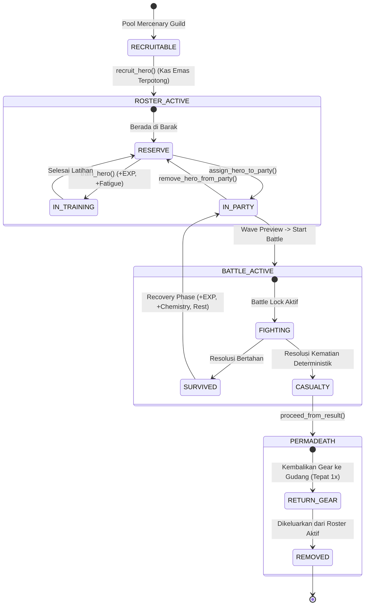

# Phase 4 — Hero System Technical Plan & Architecture Specification

## Project Context
- **Project:** `fortress_game`
- **Repository:** `https://github.com/AchmadKing/fortress_game.git`
- **Branch:** `main`
- **Current Phase:** Phase 4 — Hero System
- **Current Status:** AUTHORIZED / PLANNING
- **Previous Phases:** Phase 0–3 COMPLETED & OFFICIALLY CLOSED (Commit `e6c0c97`)

---

## A. Phase Objective

Phase 4 bertujuan membangun **Hero System (Sistem Pahlawan & Komandan)** yang utuh, mendalam, dan modular, memperluas fondasi hero minimal yang telah divalidasi pada Phase 1, Phase 2, dan Phase 3C/3D/3E.

Sistem pahlawan dirancang dengan kedalaman *character-management strategy RPG* yang berfokus pada:
1. Identitas dan perkembangan individual setiap pahlawan (level, EXP, stat, bintang saat ini vs potensi).
2. Peran (*Hero Role*) dan sinergi perlengkapan yang terintegrasi dengan gudang bersama (*Shared Fortress Warehouse*).
3. Pengelolaan stamina, kelelahan (*fatigue*), dan moral (*morale*).
4. Fasilitas pelatihan (*Training Facility*) dan sistem rekrutmen pahlawan (*Mercenary Guild*).
5. Pembentukan regu pahlawan (*Party System*) dan penguatan hubungan kemitraan tempur (*Hero Chemistry*).
6. Fondasi bakat dan kemampuan (*Skills & Talent Foundation*).
7. Konsekuensi kematian permanen (*Permadeath*) yang deterministik dengan jaminan konservasi kepemilikan perlengkapan.

> [!IMPORTANT]
> **Prinsip Utama: EXTEND, DON'T BREAK**
> Phase 4 BUKAN penulisan ulang (*rewrite*). DILARANG membuat `HeroModelV2`, dilarang membuat gudang inventaris kedua khusus hero, dan dilarang mengganti kontrak domain Phase 1–3 yang sudah tervalidasi. Seluruh penambahan dilakukan secara aditif di atas arsitektur yang sudah ada.

---

## B. Existing Hero Foundation Audit & Inviolable Rules

### 1. Existing Hero Foundation (Yang Wajib Dipertahankan)
Repositori pada commit `e6c0c97` telah memiliki fondasi pahlawan fungsional:
- **Model Domain (`scripts/domain/model/hero_model.gd`):**
  - Identitas: `hero_id: String`, `hero_name: String`.
  - Tingkat & EXP: `level: int = 1`, `current_exp: int = 0`.
  - Sistem Bintang: `current_star: int = 1`, `potential_star: int = 3`.
  - Stat Dasar: `base_hp: int = 250`, `base_atk: int = 35`, `base_def: int = 20`.
  - Kondisi: `fatigue: int = 0` (0–100), `morale: int = 100` (0–150), `is_alive: bool = true`.
  - Kemitraan: `chemistry_map: Dictionary` (`partner_hero_id -> points`).
  - Slot Perlengkapan (Phase 3C): `primary_equipment`, `secondary_equipment`, `armor_equipment`.
  - Metode: `equip()`, `unequip()`, `has_equipment()`, `get_equipment()`, `get_equipped_items()`, `clear_equipment()`, `get_required_exp()`, `add_exp()`, `add_fatigue()`, `rest()`, `train()`, `add_chemistry()`, `get_chemistry_bonus()`, `get_fatigue_multiplier()`, `get_effective_atk()`, `get_effective_def()`, `mark_dead()`, `clone()`.
- **Koordinasi Aplikasi (`scripts/application/coordinators/game_coordinator.gd`):**
  - Koleksi pahlawan benteng: `_heroes: Array` (default awal: `hero_alder` dan `hero_lyra`).
  - Slot perlengkapan terintegrasi gudang bersama: `equip_hero()`, `unequip_hero()`, `swap_hero_equipment()`, `get_hero()`.
  - Proteksi Battle Lock: mutasi perlengkapan hero dilarang keras saat state `BATTLE`.
  - Pengembalian perlengkapan hero permadeath tepat 1 kali pada fase `proceed_from_result()`.
  - Pemulihan kelelahan pasca-tempur (`hero.rest(20)` jika `fatigue >= 30`).
  - Serialisasi data pahlawan ke `GameStateSnapshot.heroes_data`.
- **Simulasi Pertempuran (`scripts/simulation/combat_engine.gd`):**
  - Kontribusi ATK hero ke fase pertempuran jarak dekat (*melee engagement*).
  - Penambahan kelelahan pertempuran: `hero.add_fatigue(15)`.
  - Peningkatan sinergi chemistry pahlawan dalam party tempur: `+2` poin per pertempuran.
  - Resolusi kelangsungan hidup / kematian hero deterministik berbasis bahaya jebolan, pertahanan, dan kelelahan.
  - Pembagian EXP tempur rata ke seluruh pahlawan hidup.

### 2. Aturan Penguncian Mutlak (Inviolable Rules)
- **NEVER** membuat `HeroModelV2` atau kelas paralel pengganti `HeroModel`.
- **NEVER** membuat sistem inventaris kedua khusus hero.
- **NEVER** membuat gudang (*Warehouse*) kedua. Gudang senjata benteng bersama (`_warehouse`) adalah satu-satunya sumber kepemilikan fisik perlengkapan.
- **NEVER** menduplikasi kalkulasi chemistry di luar domain `HeroModel`.
- **NEVER** menduplikasi kalkulasi EXP di luar domain `HeroModel`.
- **NEVER** menduplikasi logika kepemilikan perlengkapan hero.
- **NEVER** mengganti API Phase 3 yang sudah berjalan tanpa alasan kompatibilitas yang terbukti melalui pengujian regresi.

---

## C. Architecture Boundary & Stat Ownership

### 1. Batas Tanggung Jawab Lapisan (*Layer Boundaries*)
```
┌─────────────────────────────────────────────────────────────┐
│                     PRESENTATION LAYER                      │
│   (GameController, PrototypeDebugView, HeroManagementView)  │
│      - MURNI menampilkan data snapshot                     │
│      - Menangkap input aksi pemain (Train, Rest, Assign)    │
│      - DILARANG menghitung gameplay/rumus stat di UI        │
└──────────────────────────────▲──────────────────────────────┘
                               │ (Commands & Signals)
┌──────────────────────────────┴──────────────────────────────┐
│                     APPLICATION LAYER                       │
│                     (GameCoordinator)                       │
│      - Mengorkestrasi siklus hidup Hero                     │
│      - Mengelola Roster Pahlawan & Penugasan Party          │
│      - Menegakkan Battle Lock & State Transitions           │
│      - Mengkoordinasikan Gudang Bersama & Kas Emas Benteng  │
└──────────────────────────────▲──────────────────────────────┘
                               │ (Calls Simulation / Mutates Models)
┌──────────────────────────────┴──────────────────────────────┐
│                    DOMAIN & SIMULATION                      │
│         (HeroModel, HeroRole, PartyModel, CombatEngine)     │
│      - Single Source of Truth rumus stat, EXP, & kondisi    │
│      - Model data individual murni (RefCounted)             │
│      - Deterministik, bebas dependensi visual/Node          │
└─────────────────────────────────────────────────────────────┘
```

### 2. Otoritas Tunggal Kalkulasi Stat (*Stat Calculation Ownership*)
DILARANG KERAS membiarkan `HeroModel`, `GameCoordinator`, `CombatEngine`, dan `UI` masing-masing menghitung stat versinya sendiri.

**Single Source of Truth Rules:**
- **`HeroModel`** adalah pemilik tunggal dan otoritas absolut untuk seluruh formula stat pahlawan:
  - `get_effective_atk()` mengintegrasikan `base_atk`, level scaling, star scaling, chemistry bonus, fatigue multiplier, dan gear multiplier.
  - `get_effective_def()` mengintegrasikan `base_def`, level scaling, star scaling, fatigue multiplier, dan gear def multiplier.
  - `get_fatigue_multiplier()` adalah otoritas tunggal penalti kelelahan.
  - `get_chemistry_bonus()` adalah otoritas tunggal pengali sinergi kemitraan.
- **`CombatEngine`** MURNI membaca hasil `hero.get_effective_atk(party_ids)` dan `hero.get_effective_def()` dari domain. Tidak boleh menghitung ulang formula pengali stat hero secara terpisah.
- **`GameCoordinator`** hanya meneruskan nilai stat efektif ke `GameStateSnapshot` untuk keperluan telemetri.
- **`Presentation / UI`** hanya menampilkan nilai dari snapshot tanpa kalkulasi ulang.

---

## D. Domain Models & Equipment/Role Scope

### 1. Pemisahan Tegas Perlengkapan Existing vs Rencana Masa Depan
- **Perlengkapan Sah Existing (Phase 3 Equipment — UNTOUCHED):**
  - Senjata: `SWORD`, `SPEAR`, `BOW`.
  - Sekunder: `SHIELD`, `NONE`.
  - Zirah: `HEAVY_ARMOR`, `NONE`.
  - Seluruh perlengkapan ini berada di gudang bersama dan berlaku untuk serdadu maupun pahlawan.
- **Kategori Perlengkapan Masa Depan (*Future Data Extensions Only*):**
  - Konsep perlengkapan seperti `STAFF`, `MACE`, `LIGHT_ARMOR`, `CLOTH` adalah rencana data masa depan.
  - **Sub-Phase 4A DILARANG** membuat sistem inventaris baru atau menginstansiasi item jenis baru tersebut.
  - Pada Phase 4, peran pahlawan menggunakan aturan kompatibilitas perlengkapan kanonikal:
    - `KNIGHT`: `SWORD` (Primary), `SHIELD` (Secondary), `HEAVY_ARMOR` (Armor).
    - `ARCHER`: `BOW` (Primary), `NONE` (Secondary), `LIGHT_ARMOR` (Armor, future); `HEAVY_ARMOR` dilarang.
    - `MAGE`: Perlengkapan masa depan (`STAFF`, `WAND` Primary, `ROBE` Armor; seluruh perlengkapan Phase 3 tidak kompatibel).
    - `PRIEST`: Perlengkapan masa depan (`STAFF` Primary, `HOLY_EQUIPMENT` Secondary, `ROBE` Armor; seluruh perlengkapan Phase 3 tidak kompatibel).
- **Aturan Gudang & Durabilitas:**
  - Perlengkapan pahlawan tetap mengambil fisik dari gudang bersama benteng (`_warehouse`).
  - Perlengkapan pahlawan **TIDAK TERPENGARUH** oleh formula keausan serdadu maupun resolusi korban serdadu (35% hancur / 65% rusak). Perlengkapan pahlawan tetap utuh selama pahlawan hidup.

### 2. Ekstensi `HeroModel` (`scripts/domain/model/hero_model.gd`)
Mempertahankan 100% kompatibilitas backward, menambahkan field secara modular:
- `role: String = "KNIGHT"`: Nilai peran kanonikal (`KNIGHT`, `MAGE`, `ARCHER`, `PRIEST`).
- `lifecycle_state: String = "ROSTER_ACTIVE"`: Status siklus hidup pahlawan.
- `party_id: String = ""` (`"party_1"`, `"party_2"`, atau `""` jika Reserve).
- `unlocked_skills: Array[String] = []`: Daftar ID skill aktif/pasif.
- `talent_points: int = 0`: Poin bakat yang tersedia.
- `allocated_talents: Dictionary = {}`: Peta bakat teralokasi (`talent_id -> level`).
- `training_sessions_wave: int = 0`: Pelacak anti-exploit latihan per gelombang.

### 3. Peran Pahlawan Kanonikal (`HeroRole`)
Didefinisikan sebagai konstanta data-driven murni:
- Konstanta: `ROLE_KNIGHT = "KNIGHT"`, `ROLE_MAGE = "MAGE"`, `ROLE_ARCHER = "ARCHER"`, `ROLE_PRIEST = "PRIEST"`.
- Validasi peran melalui method statis: `HeroRole.is_valid_role(role: String) -> bool`.
- Kompatibilitas slot senjata/zirah diperiksa secara deterministik tanpa duplikasi kode.

### 4. Model Regu Pahlawan (`PartyModel`)
- Model data murni (`RefCounted`):
  - `party_id: String` (misal: `"party_1"`, `"party_2"`).
  - `party_name: String`.
  - `leader_hero_id: String`.
  - `member_hero_ids: Array[String]`.
  - `is_deployed_to_battle: bool`.

---

## E. Data Ownership

| Komponen Data | Otoritas Kepemilikan (*Owner*) | Hak Mutasi |
| :--- | :--- | :--- |
| **Identitas, Stat, & EXP Hero** | `HeroModel` | Murni internal `HeroModel` via metode domain. |
| **Peralatan Terpasang** | `HeroModel` (Referensi) | Dikendalikan via `GameCoordinator` (Single Source Gudang Bersama). |
| **Roster Pahlawan Benteng** | `GameCoordinator` (`_heroes`) | `recruit_hero()`, `dismiss_hero()`, `proceed_from_result()`. |
| **Penugasan Party** | `GameCoordinator` / `PartyModel` | `assign_hero_to_party()`, `remove_hero_from_party()`. |
| **Fasilitas Latihan** | `GameCoordinator` & `EconomyManager` | `train_hero()`, konsumsi Gold dan kelelahan. |
| **Perhitungan Tempur** | `CombatEngine` | Murni membaca stat efektif pahlawan saat pertempuran. |

---

## F. Hero Lifecycle & States

### 1. State Siklus Hidup Pahlawan (`HeroLifecycleState`)
- `RECRUITABLE`: Berada di bursa Mercenary Guild, belum menjadi bagian benteng.
- `ROSTER_ACTIVE`: Terdaftar resmi di benteng sebagai cadangan (*Reserve*) atau bertugas di barak.
- `IN_PARTY`: Ditugaskan ke dalam salah satu regu tempur pahlawan.
- `IN_TRAINING`: Sedang menjalani sesi latihan pada fase persiapan.
- `BATTLE_ACTIVE`: Sedang berada di medan laga aktif (berlaku Battle Lock).
- `PERMADEATH`: Gugur di medan laga; seluruh perlengkapan dikembalikan ke gudang, status `is_alive = false`.

### 2. Diagram Transisi Siklus Hidup


---

## G. Recruitment Flow (Mercenary Guild)

1. **Penyegaran Kandidat Deterministik:**
   - Awal fase `PREPARATION`: `GameCoordinator` menyediakan 2–3 kandidat hero di bursa sewa.
   - Kandidat dibuat secara deterministik berbasis `_session_seed + current_wave`.
2. **Biaya Rekrutmen (Gold):**
   $$\text{Hiring Cost} = \text{base\_cost} \times \text{current\_star} \times (1 + (\text{potential\_star} - \text{current\_star}) \times 0.35)$$
   - Hero Bintang 1 (Potensi 3): $50 \times 1 \times (1 + 2 \times 0.35) = 85 \text{ Gold}$.
3. **Validasi:**
   - Kas benteng mencukupi ($\text{Treasury Gold} \ge \text{Cost}$).
   - Roster pahlawan benteng belum penuh (maksimal 6 pahlawan pada MVP).
   - `hero_id` unik terverifikasi (mencegah ID duplikat).

---

## H. Progression Flow & Level Caps

1. **Kenaikan Level (*Level Up*):**
   - Saat $\text{current\_exp} \ge \text{ReqEXP}(\text{level})$, level pahlawan naik $+1$.
   - Kelebihan EXP diteruskan (*carry-over*) ke tingkat berikutnya.
   - Peningkatan stat otomatis: $+12\%$ ATK dan $+10\%$ DEF per level.
   - Mendapatkan $+1$ Poin Bakat (*Talent Point*) setiap level ganjil.
2. **Batas Level Maksimal Berbasis Bintang (*Star Level Cap*):**
   - Bintang 1: Level Maksimal $10$.
   - Bintang 2: Level Maksimal $20$.
   - Bintang 3: Level Maksimal $30$.
   - Bintang 4: Level Maksimal $40$.
   - Bintang 5: Level Maksimal $50$.
   - Pahlawan yang mencapai level cap tidak dapat memperoleh EXP lebih lanjut sampai melakukan kenaikan bintang (*Ascension*).

---

## I. EXP Formulas

### 1. Kebutuhan EXP per Level
$$\text{ReqEXP}(L) = \lfloor 120.0 \times L^{1.55} \rfloor$$
- Lv 1 $\rightarrow$ 2: $120$ EXP
- Lv 2 $\rightarrow$ 3: $351$ EXP
- Lv 3 $\rightarrow$ 4: $658$ EXP
- Lv 4 $\rightarrow$ 5: $1,028$ EXP

### 2. Perolehan EXP Tempur
Dibagikan secara merata kepada seluruh pahlawan yang bertarung dan bertahan hidup:
$$\text{EXP}_{\text{battle}} = \left\lfloor 60.0 \times \left(1.0 + \frac{\text{Wave}}{15.0}\right) \right\rfloor$$

---

## J. Star / Potential Progression Rules (Ascension)

1. **Integritas Bintang:**
   $$1 \le \text{current\_star} \le \text{potential\_star} \le 5$$
2. **Syarat Kenaikan Bintang (*Ascension*):**
   - Pahlawan mencapai level cap pada bintangnya saat ini ($\text{level} == \text{current\_star} \times 10$).
   - Pahlawan belum mencapai batas potensi ($\text{current\_star} < \text{potential\_star}$).
   - Membayar biaya emas benteng: $\text{Ascension Cost} = \text{current\_star} \times 150 \text{ Gold}$.
3. **Efek Ascension:**
   - `current_star` bertambah $+1$.
   - Batas level terbuka ke tingkat berikutnya.
   - Pengali stat tempur bertambah $+20\%$ per bintang:
     $$\text{Star Multiplier} = 1.0 + (\text{current\_star} - 1) \times 0.20$$

---

## K. Fatigue Rules

1. **Batas Nilai:** Integer $0$ hingga $100$.
2. **Penumpukan Kelelahan:**
   - Bertempur di medan laga: $+15$ poin per pertempuran.
   - Sesi latihan di benteng: $+25$ poin per sesi latihan.
3. **Dampak Kelelahan:**
   - **Kinerja Tempur:** Jika $\text{fatigue} > 20$, daya serang dan pertahanan tereduksi linier hingga batas bawah $40\%$ ($\text{fatigue} = 100$).
   - **Risiko Permadeath:** Kelelahan memperbesar peluang gugur deterministik saat tembok benteng jebol hingga $+60\%$.
   - **Kesiapan Latihan:** Jika $\text{fatigue} \ge 75$, pahlawan dilarang berlatih (*exhausted*).
4. **Pemulihan Kelelahan:**
   - Istirahat pasca-tempur normal (fase RECOVERY): $-20$ poin.
   - Istirahat penuh di barak (status `RESERVE`): $-40$ poin.

---

## L. Morale Rules

1. **Batas Nilai:** Integer $0$ hingga $150$ (baseline normal = $100$).
2. **Dinamika Moral:**
   - Kemenangan gelombang: $+5$ poin.
   - Jebolan tembok parah: $-10$ poin.
   - Rekan pahlawan gugur permanen: $-25$ poin.
3. **Efek Moral:**
   - **Tinggi ($\text{morale} \ge 120$):** Bonus $+5\%$ efektivitas stat.
   - **Normal ($80 \le \text{morale} < 120$):** Tanpa modifikator.
   - **Rendah ($\text{morale} < 80$):** Penalti $-10\%$ efektivitas stat.

---

## M. Training Rules (Training Facility)

1. **Waktu Akses:** Dilakukan secara interaktif pada fase `PREPARATION`.
2. **Biaya & Hasil:**
   - Biaya: $25$ Gold dari kas bendahara benteng.
   - Hasil: $+150$ EXP seketika dan $+25$ poin kelelahan (*fatigue*).
3. **Syarat & Larangan:**
   - Pahlawan dalam keadaan hidup dan $\text{fatigue} < 75$.
   - Kas benteng mencukupi ($\ge 25$ Gold).
   - Pahlawan belum mencapai level cap bintang saat ini.
4. **Klarifikasi Batasan Anti-Exploit:**
   - Aturan `maksimal 1 sesi latihan per pahlawan per gelombang` adalah **aturan pembatasan anti-exploit** agar pemain tidak menghabiskan seluruh kas emas untuk menaikkan level instan dalam satu gelombang.
   - Ini **BUKAN** batasan kapasitas gedung fasilitas latihan benteng. Fasilitas benteng itu sendiri tidak memiliki batasan kapasitas kuota pahlawan pada MVP.

---

## N. Chemistry Rules & Ownership

1. **Otoritas Tunggal Chemistry:**
   - `HeroModel` adalah pemilik tunggal peta kemitraan (`chemistry_map`) dan kalkulasi bonus (`get_chemistry_bonus`).
   - Dilarang membuat peta chemistry paralel di `CombatEngine` maupun `GameCoordinator`.
2. **Mekanik Perkembangan Positif:**
   - Pasangan pahlawan yang bertarung bersama dalam satu party memperoleh $+2$ poin per pertempuran (maksimal $50$ poin per pasangan).
   - Bonus efektivitas tempur:
     $$\text{Chemistry Multiplier} = 1.0 + (\text{Total Chemistry Points with Active Party} \times 0.005)$$
   - Murni mekanik sinergi positif tanpa penalti kecemburuan atau permusuhan.
   - Pahlawan yang gugur permanen menghapus catatan kemitraannya.

---

## O. Party Model Scope & Limitations

1. **Batasan Manajemen Regu Phase 4:**
   - Maksimal **2 regu** dalam fondasi manajemen (`Party 1` dan `Party 2`).
   - Maksimal **3 pahlawan** per regu.
   - Setiap pahlawan hanya boleh terdaftar di maksimal satu regu.
   - Pahlawan yang tidak ditugaskan ke regu berstatus `RESERVE` (istirahat di barak).
2. **Batasan Tempur Sementara Phase 4 (*Temporary Management Limitation*):**
   - Pada Phase 4, **hanya `Party 1` yang diteruskan ke `CombatEngine` sebagai regu tempur aktif**.
   - `Party 2` berfungsi murni sebagai struktur data organisasi cadangan dan persiapan rotasi pemain di barak. `Party 2` belum memiliki fungsi taktis medan laga di Phase 4.
3. **Batas Tegas (Out of Scope untuk Phase 4):**
   - DILARANG mengimplementasikan pergerakan taktis medan tempur, pergantian party saat pertempuran berlangsung (*mid-battle party switching*), pathfinding, formasi fisik visual, dan perintah taktis party. Seluruh aspek tersebut milik Phase 6.

---

## P. Skill & Talent Foundation

1. **Arsitektur Ringan:**
   - Model data `HeroSkill` mewarisi `RefCounted`.
   - Menampung nama, peran, syarat level, tipe (Pasif Stat / Aura), dan pengali kekuatan.
2. **Pohon Bakat Sederhana (*Simple Talent Tree*):**
   - Tiga cabang bakat dasar per peran (contoh Knight: *Offense, Defense, Leadership*).
   - Alokasi menggunakan Poin Bakat (*Talent Points*) yang diperoleh saat naik level ganjil.

---

## Q. Equipment Integration & Shared Warehouse Invariant

1. **Konservasi Kepemilikan Fisik:**
   $$\text{Total Owned} = \text{Warehouse Usable} + \text{Warehouse Damaged} + \text{Hero Held} + \text{Soldier Reserved}$$
2. **Persistensi Pahlawan Selamat:**
   - Perlengkapan pahlawan yang selamat tetap terpasang lintas gelombang dan tidak kembali ke gudang kecuali dilepas manual.
3. **Isolasi dari Aturan Aus Serdadu:**
   - Perlengkapan pahlawan tidak mengalami degradasi keausan tempur rutin dan tidak terkena aturan korban 35% musnah / 65% rusak.
4. **Proteksi Battle Lock:**
   - Seluruh mutasi perlengkapan hero (`equip`, `unequip`, `swap`) dilarang keras saat state `BATTLE`.

---

## R. Death / Permadeath Handling

1. **Evaluasi Deterministik:**
   - Dihitung saat pertempuran di `CombatEngine._resolve_hero_survival_and_death`.
2. **Prosedur Pasca-Kematian:**
   - Status diubah menjadi `is_alive = false`.
   - Pada fase `proceed_from_result()`:
     - Seluruh perlengkapan yang terpasang pada pahlawan gugur dikembalikan ke gudang benteng **tepat satu kali**.
     - Slot perlengkapan pahlawan dikosongkan (`clear_equipment()`).
     - Pahlawan dikeluarkan dari regu tempur.
     - Invariant gudang bersama terbukti tetap seimbang.

---

## S. UI & Interaction Scope (Prototype Debug View)

Perluasan visual interaktif pada `prototype_debug_view.gd` dirancang fungsional dan modular:
1. **Hero Roster List:** Menampilkan kartu pahlawan, level, EXP, bintang/potensi, kelelahan, moral, peran, dan perlengkapan.
2. **Party Management Panel:** Penugasan pahlawan ke `Party 1`, `Party 2`, atau `Reserve`.
3. **Training & Ascension Controls:** Tombol `[Latih Pahlawan]` dan `[Ascension Bintang]`.
4. **Mercenary Guild Board:** Daftar pahlawan yang dapat disewa pada fase PREPARATION.

---

## T. Test Strategy

Setiap sub-fase Phase 4 wajib menyertakan automated headless test suite:
1. **Unit Test Domain:** Logika stat, EXP curve, batas kelelahan, dan alokasi poin bakat.
2. **Integration Test:** Perekrutan, penugasan party, eksekusi latihan, dan persistensi perlengkapan lintas gelombang.
3. **Permadeath & Conservation Test:** Pengembalian perlengkapan hero gugur dan integritas invarian gudang bersama.
4. **Stress & Stability Test:** Menjalankan multi-wave hero progression tanpa kebocoran memori atau loop tak terbatas.

---

## U. Regression Strategy & Inviolable Baseline

- **Baseline Pengujian Wajib (100% PASS):**
  - Phase 1 Architecture Boundaries: **5/5 PASS**
  - Phase 2 Mathematical Systems: **21/21 PASS**
  - Phase 3A Gameplay Baseline: **11/11 PASS**
  - Phase 3B Soldier Deployment: **27/27 PASS**
  - Phase 3C Hero Equipment Foundation: **22/22 PASS**
  - Phase 3D Prototype UX & Polish: **10/10 PASS**
  - Phase 3D Follow-up Corrections: **23/23 PASS**
  - Phase 3E Final Verification: **15/15 PASS**
  - Scene Smoke Playtest: **ALL PASS**
- **Total Baseline:** **134 Unit & Integration Tests + 1 Smoke Playtest Suite (100% PASS)**.
- Dilarang menghapus atau mengubah pengujian existing hanya agar kode Phase 4 terlihat lulus.

---

## V. Performance Constraints

1. Pahlawan direpresentasikan sebagai objek domain ringan (`RefCounted`).
2. Dilarang menghitung stat pahlawan setiap frame (`_process` / `_physics_process`). Kalkulasi hanya dilakukan secara reaktif saat ada mutasi state.
3. Kapasitas roster pahlawan benteng dibatasi maksimal 6 pahlawan pada MVP.
4. Perekrutan Mercenary Guild dibatasi maksimal 3 kandidat per gelombang.

---

## W. Phase 4 Sub-Phases & Explicit Dependencies

### 1. Rantai Ketergantungan (*Dependency Chain*)
```
[4A: Domain Foundation] 
       └──> [4B: Progression & Ascension] 
                 └──> [4C: Recruitment & Roster] 
                           └──> [4D: Training & Fatigue] 
                                     └──> [4E: Skills & Talents] 
                                               └──> [4F: Party & Chemistry] 
                                                         └──> [4G: Management UX] 
                                                                   └──> [4H: Integration & Verification]
```

### 2. Aturan Kerja Wajib Setiap Sub-Fase (8-Step Workflow):
1. **Inspect First:** Periksa kondisi kode dan ketergantungan existing terlebih dahulu.
2. **Define Exact Scope:** Batasi cakupan secara ketat sesuai rencana sub-fase.
3. **Implement Only That Scope:** Kerjakan hanya cakupan yang disepakati tanpa mendahului sub-fase berikutnya.
4. **Add Tests:** Buat test suite baru khusus untuk sub-fase tersebut.
5. **Run Regression:** Jalankan seluruh pengujian lama (baseline 134 test) dan test baru.
6. **Verify Smoke Playtest:** Pastikan scene prototipe tetap berfungsi tanpa regresi.
7. **Commit:** Buat git commit dengan pesan yang jelas dan terstandarisasi.
8. **Stop & Report:** Berhenti dan tunggu tinjauan/persetujuan developer sebelum membuka sub-fase berikutnya.

### 3. Batas Eksplisit Sub-Phase 4A (Hero Domain & Lifecycle Foundation) — IMPLEMENTED
- **STATUS: COMPLETED / VERIFIED (Correction Gate passed, 38/38 Tests PASS, Full Regression 172/172 Tests PASS)**
- **IN SCOPE FOR 4A (IMPLEMENTED):**
  - Definisi peran kanonikal (`HeroRole`: `KNIGHT`, `MAGE`, `ARCHER`, `PRIEST`).
  - Representasi state siklus hidup pahlawan (`HeroLifecycleState`: `RECRUITABLE`, `ROSTER_ACTIVE`, `IN_PARTY`, `IN_TRAINING`, `BATTLE_ACTIVE`, `PERMADEATH`).
  - Validasi transisi legal dan penegakan `PERMADEATH` sebagai state terminal mutlak.
  - Validasi domain hero (memastikan ID sah, nama tidak kosong, peran valid, bintang $\le$ potensi $\le 5$ tanpa silent normalization).
  - Validasi kompatibilitas peran kanonikal terhadap perlengkapan Phase 3 existing dan kontrak data future equipment (`is_equipment_compatible`).
  - Ekstensi aman pada `HeroModel` tanpa mematahkan API atau field existing.
  - Test suite mandiri `tests/test_phase4a_hero_domain_lifecycle.gd` (38/38 PASS).
  - Sinkronisasi dokumentasi teknis.
- **OUT OF SCOPE FOR 4A (DILARANG PADA 4A):**
  - Rekrutmen dan bursa Mercenary Guild (Milik 4C).
  - UI rekrutmen dan roster (Milik 4G).
  - Perubahan EXP curve dan leveling (Milik 4B).
  - Kenaikan bintang / ascension (Milik 4B).
  - Aksi latihan fasilitas benteng (Milik 4D).
  - Redesain kelelahan atau moral (Milik 4D).
  - Sistem skill dan pohon bakat (Milik 4E).
  - Model party dan chemistry baru (Milik 4F).
  - Taktik pertempuran dan AI musuh baru (Milik Phase 6).
  - Inventaris atau jenis perlengkapan baru (Dilarang).
  - Pixel art dan visual mobile final (Milik Phase 9).

### 4. Batas Eksplisit Sub-Phase 4B (Hero Progression & EXP) — IMPLEMENTED
- **STATUS: COMPLETED / VERIFIED (47/47 Tests PASS, Full Regression 219/219 Tests PASS, Scene Smoke Playtest ALL PASS)**
- **IN SCOPE FOR 4B (IMPLEMENTED):**
  - Formula kebutuhan EXP kanonikal: $\text{ReqEXP}(L) = \lfloor 120.0 \times L^{1.55} \rfloor$.
  - Progresi level hero dengan akumulasi carry-over EXP dan dukungan kenaikan multi-level seketika.
  - Batas level maksimal berbasis bintang saat ini: $\text{Level Cap} = \text{current\_star} \times 10$ ($1\star=10, 2\star=20, 3\star=30, 4\star=40, 5\star=50$). Hero di level cap tidak dapat naik level lagi.
  - Formula dan aturan kelayakan Ascension: $1 \le \text{current\_star} < \text{potential\_star} \le 5$, hero hidup, tidak permadeath, dan $\text{level} \ge \text{current\_star} \times 10$.
  - Formula biaya Ascension: $\text{current\_star} \times 150 \text{ Gold}$.
  - Transaksi atomik Ascension di `GameCoordinator`: validasi status non-BATTLE (Battle Lock), ketersediaan kas bendahara, deduksi Gold atomik, dan mutasi kenaikan bintang $+1$.
  - Formula Battle EXP kanonikal di `CombatEngine`: $\lfloor 60.0 \times (1.0 + \text{Wave} / 15.0) \rfloor$.
  - Distribusi Battle EXP deterministik kepada pahlawan yang bertahan hidup dengan pembagian rata dan alokasi sisa (*remainder*) berbasis urutan alfabetik `hero_id`.
  - Telemetri snapshot: integrasi atribut `potential_star`, `level_cap`, `can_ascend`, dan `ascension_cost` pada `GameStateSnapshot.heroes_data`.
  - Test suite mandiri `tests/test_phase4b_hero_progression.gd` (47/47 PASS).
- **OUT OF SCOPE FOR 4B (DILARANG PADA 4B):**
  - Bursa Mercenary Guild, penawaran kandidat hero, batas kapasitas roster pahlawan (Milik 4C).
  - Aksi latihan fasilitas benteng (*Training Facility*), interaksi latihan dan batas kelelahan $\ge 75$ (Milik 4D).
  - Redesain kelelahan atau dinamika moral (Milik 4D).
  - Sistem skill dan pohon bakat (Milik 4E).
  - Model party dan chemistry baru (Milik 4F).
  - Hero Management UI & Ascension UI (Milik 4G).
  - Taktik pertempuran dan AI musuh baru (Milik Phase 6).
  - Inventaris atau jenis perlengkapan baru (Dilarang).
  - Pixel art dan visual mobile final (Milik Phase 9).

---

## X. Acceptance Criteria Phase 4

Phase 4 dinyatakan selesai hanya jika seluruh kriteria berikut terpenuhi:
- [ ] Model `HeroModel` telah diperluas mencakup peran kanonikal, bakat, keahlian, dan regu tanpa merusak API Phase 3.
- [ ] Sistem rekrutmen Mercenary Guild berfungsi deterministik dan terintegrasi dengan kas emas benteng.
- [x] Sistem progresi level, kenaikan bintang (*Ascension*), dan pembatasan level berbasis bintang berjalan akurat.
- [ ] Fasilitas latihan (*Training Facility*) berfungsi dengan konsumsi emas dan penambahan kelelahan yang adil.
- [ ] Pemisahan stamina (kelelahan) dan moral berfungsi independen dan mempengaruhi performa tempur.
- [ ] Sistem Party memisahkan pahlawan tempur dan cadangan secara transparan.
- [ ] Invariant konservasi gudang bersama $\text{Total} = \text{USBL} + \text{DMGD} + \text{HERO} + \text{REGD}$ tetap valid 100%.
- [ ] Seluruh perlengkapan pahlawan permadeath kembali ke gudang bersama tepat 1 kali.
- [ ] Seluruh 134 baseline test existing tetap PASS 100%.
- [ ] Test suite baru untuk seluruh sub-fase Phase 4 lulus 100%.
- [ ] Scene Smoke Playtest terintegrasi lulus tanpa error di Godot Editor.

---

## Y. Explicit Exclusions (Batas Tegas di Luar Phase 4)

Hal-hal berikut **DILARANG KERAS** diimplementasikan pada Phase 4:
- ❌ Pergerakan taktis unit hero di medan tempur real-time (Milik Phase 6).
- ❌ Navigasi pathfinding dan formasi fisik di lapangan (Milik Phase 6).
- ❌ Animasi pertempuran visual kompleks, sprite pixel art final, dan visual effect (Milik Phase 9).
- ❌ Fasilitas bangunan benteng baru selain integrasi logika fasilitas latihan (Milik Phase 5).
- ❌ Sistem ekonomi lanjutan, pasar perdagangan, pajak sipil mendalam (Milik Phase 5 & 7).
- ❌ Sistem gacha berbayar, mikrotransaksi, atau mekanik real-money (Ditolak permanen dari desain game).
- ❌ Overhaul sistem save/load persistence ke database eksternal (Milik Phase 10).
