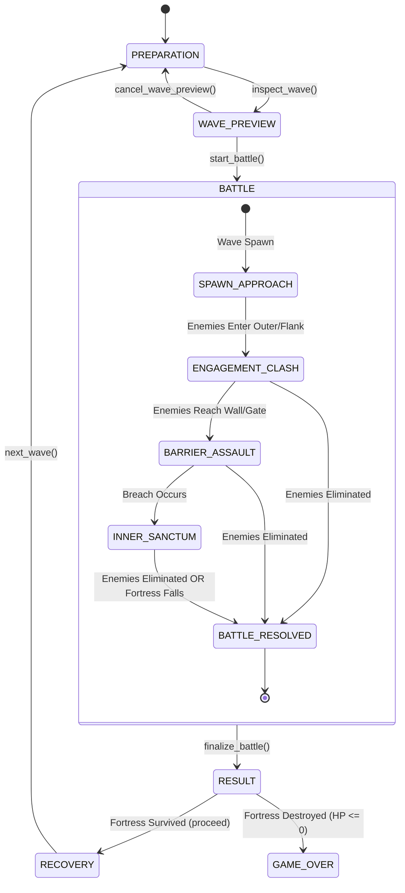
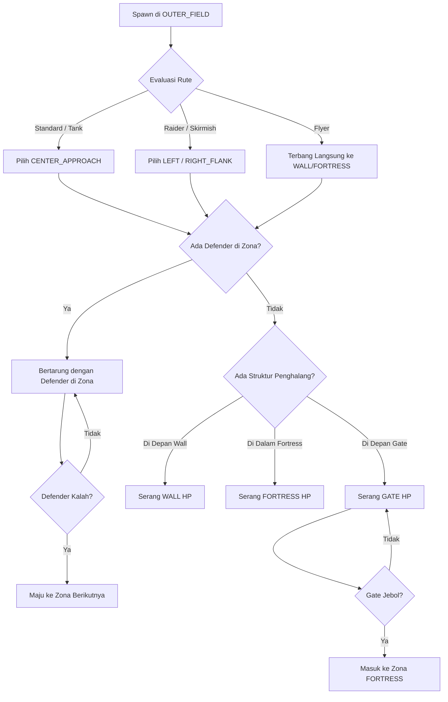

# Phase 6 — Tactical Battle & Battlefield Systems Architecture Plan
## Technical Specification & Implementation Roadmap

> **Status**: PROPOSED / ARCHITECTURE PLANNING ONLY (DO NOT IMPLEMENT YET)  
> **Target Milestone**: Phase 6 — Tactical Battle & Battlefield Systems  
> **Prerequisites**: Phase 0–5 COMPLETED / CLOSED  
> **Branch**: `main`  
> **Repository**: `https://github.com/AchmadKing/fortress_game.git`  
> **Hardware Budget**: Mobile Android / Lightweight Dev Machine (Intel Celeron/Pentium, 4 GB RAM, No Dedicated GPU)

---

## 1. Goal & Vision

Phase 6 mengubah prototipe manajemen benteng (Phase 5) menjadi **sistem simulasi pertempuran taktis real-time yang dapat diamati dan diarahkan (*observable & commandable tactical battle simulation*)**, mengadopsi filosofi desain menyerupai **Football Manager**:
1. **Player as Commander**: Pemain tidak mengontrol karakter individual secara mikro (bukan RTS unit-clicking, bukan action hack-and-slash). Pemain bertindak sebagai komandan perang benteng yang mengamati pertempuran dari sudut pandang makro dan memberikan perintah strategis/taktis kepada regu (*party / unit deployment groups*).
2. **Real-Time Deterministic Simulation**: Pertempuran berjalan secara real-time berbasis *discrete simulation ticks* dengan kontrol tempo penuh (Pause, 0.5x, 1x, 2x, 4x).
3. **Zone-Based Battlefield**: Medan pertempuran dibagi ke dalam zona taktis diskrit (*discrete zone topology*), bukan grid/tile ataupun physics-based continuous space.
4. **Deep Systemic Integration**: Pertempuran mengonsumsi state benteng (Fortress HP, Wall HP, Gate HP), komposisi serdadu agregat, perlengkapan gudang bersama (*Shared Warehouse*), pahlawan aktif (`party_1` stats, fatigue, morale, chemistry, talents), serta komposisi gelombang musuh (*WaveGenerator*).
5. **Strict Casualty & Conservation Continuity**: Hasil pertempuran secara deterministik memengaruhi korban serdadu, keausan/kerusakan perlengkapan ($35\%$ hancur, $65\%$ rusak), kerusakan struktur benteng, serta kenaikan EXP, kelelahan ($+15$ fatigue), dan moral pahlawan tanpa pernah mendistorsi invarian konservasi populasi dan perlengkapan.

---

## 2. Scope Boundaries

### INCLUDED (Ruang Lingkup Phase 6)
1. **Battle State Model & Lifecycle**: Siklus hidup pertempuran bertahap di dalam `GameplayStateMachine.STATE_BATTLE`.
2. **Battlefield Zone Topology**: 7 zona taktis kanonikal (`OUTER_FIELD`, `LEFT_FLANK`, `CENTER_APPROACH`, `RIGHT_FLANK`, `WALL`, `GATE`, `FORTRESS`), graf ketetanggaan (*adjacency*), dan aturan pergerakan.
3. **Enemy Wave Archetypes & Composition**: 6 arketipe musuh kanonikal (`Goblin Swarm`, `Orc Frontline`, `Goblin Archer`, `Troll Tank`, `Siege Monster`, `Flying Bypass`) dengan atribut tempur deterministik.
4. **Enemy Behavioral State Machine**: Perilaku musuh deterministik berbasis prioritas target (*priority targeting*) dan pergerakan zona.
5. **Party 1 Combat Deployment**: Integrasi pahlawan aktif di Party 1 ke medan tempur beserta aura kepemimpinan, kontribusi stat efektif, dan isolasi mutlak Party 2 / Reserve.
6. **Aggregate Soldier Combat Participation**: Partisipasi kelompok serdadu agregat berbasis penempatan sementara (*temporary deployment*) dari Phase 3B.
7. **Commander Commands System**: Implementasi efek operasional 6 perintah taktis (`HOLD`, `ADVANCE`, `RETREAT`, `PROTECT`, `FOCUS`, `FOLLOW`) pada tingkat regu/zona.
8. **Real-Time Simulation Loop**: Simulation tick deterministik dan kontrol tempo (Pause, 1x, 2x, 4x) yang hemat daya dan memori.
9. **Multi-Factor Dynamic Battle Formulas**: Kalkulasi pertempuran yang mempertimbangkan kuantitas, perlengkapan, peran, moral, kelelahan, chemistry, perintah komandan, arketipe musuh, zona, dan integritas benteng (bukan rumus tunggal *Battle Power*).
10. **Fortress, Wall & Gate Interaction**: Perutean kerusakan bertingkat ke Gate HP, Wall HP, dan Fortress HP dengan kondisi *breach* dan Game Over jika Fortress HP $\le 0$.
11. **Casualty & Equipment Resolution**: Penegakan aturan korban serdadu dan perlengkapan Phase 3D ($100\%$ selamat aman; korban: $35\%$ hilang permanen, $65\%$ rusak berat durabilitas $60\%$) serta kembalinya gear pahlawan permadeath tepat 1x ke gudang bersama.
12. **Battle Result Read Model & Data Contract**: Struktur data komprehensif `BattleResult` yang merangkum durasi, korban, kerusakan, jarahan emas (*loot*), dan EXP.
13. **State Snapshot Telemetry & Deep-Copy Isolation**: Representasi seluruh state pertempuran ke dalam `GameStateSnapshot` untuk konsumsi UI.
14. **Functional Tactical Battle UI**: Antarmuka visual fungsional pada prototype view berbasis wireframe Phase 5.
15. **Comprehensive Automated Test Suite**: Minimal 85 unit/integration tests dan stress test simulasi 50–100 wave tanpa henti.

### EXCLUDED (Dilarang Dikerjakan di Phase 6)
- ❌ Final pixel art, sprites, animasi unit, visual VFX, dan SFX (milik Phase 9).
- ❌ Polish visual/mobile gesture UI khusus Android (milik Phase 9).
- ❌ Sistem save/load persisten ke disk (milik Phase 10).
- ❌ Sistem ekonomi kompleks, crafting perlengkapan, pasar perdagangan (milik Phase 7).
- ❌ Pembuatan konten masif ratusan tipe musuh atau stage cerita (milik Phase 8).
- ❌ Entitas serdadu individual atau AI mikro per-prajurit (serdadu tetap agregat!).
- ❌ Physics engine (`RigidBody2D`, `CharacterBody2D`, `Area2D` collision shape) untuk simulasi pertarungan.
- ❌ Sistem skill aktif ber-cooldown mikro atau visual spell targeting interaktif.

---

## 3. Existing Architecture Audit & Integration Points

Audit menyeluruh terhadap sistem yang sudah berjalan membuktikan arsitektur eksisting sangat kokoh dan siap diperluas tanpa pemutusan kompatibilitas:

| Komponen Eksisting | File Path | Status & Perilaku Saat Ini | Titik Integrasi Phase 6 |
| :--- | :--- | :--- | :--- |
| **`CombatEngine`** | `scripts/simulation/combat_engine.gd` | Menjalankan `simulate_battle()` monolitik multi-fase (Fase 1–5) secara instan. | **Diperluas (Extend)**: Mempertahankan `simulate_battle()` untuk backward-compatibility & *instant resolution*, menambahkan metode simulasi bertahap: `init_battlefield()`, `step_tick()`, `is_battle_finished()`, `finalize_battle()`. Dilarang membuat `CombatEngineV2`! |
| **`WaveGenerator`** | `scripts/simulation/wave_generator.gd` | Menghasilkan komposisi musuh (`MINION`, `RAIDER`, `BRUTE`, `FLYER`, `SIEGE`, `BOSS`) berdasarkan kurva anggaran ancaman (*threat budget*). | **Dipertahankan & Dikonsumsi**: Menggunakan komposisi musuh eksisting dan memetakannya ke arketipe taktis Phase 6. |
| **`GameplayStateMachine`** | `scripts/application/state_machine/gameplay_state_machine.gd` | State global: `BOOT -> PREPARATION -> WAVE_PREVIEW -> BATTLE -> RESULT -> RECOVERY -> PREPARATION` (dan `GAME_OVER`). | **Dipertahankan 100%**: Tidak menambah state global baru. Sub-fase taktis, zona, dan status jeda dikelola di dalam `STATE_BATTLE`. |
| **`CommanderCommand`** | `scripts/domain/command/commander_command.gd` | DTO memuat `command_type` (`HOLD`, `ADVANCE`, `RETREAT`, `PROTECT`, `FOCUS`, `FOLLOW`), `target_group`, `target_id`. | **Diaktifkan**: Di Phase 3 berstatus `LOGGED_PHASE3_DEFERRED`. Di Phase 6 dieksekusi secara operasional pada simulasi zona (`ACTIVE`). |
| **`FortressModel`** | `scripts/domain/model/fortress_model.gd` | Mengelola `current_hp`/`max_hp`, `wall_hp`/`wall_max_hp`, `gate_hp`/`gate_max_hp`. | **Diintegrasikan**: Menerima kerusakan terarah dari musuh di zona Gate, Wall, atau Fortress. |
| **`PopulationModel`** | `scripts/domain/model/population_model.gd` | Mengelola `civilians`, `workers`, `soldiers` dengan invarian zero-sum. | **Diintegrasikan**: Mengonsumsi `apply_casualties()` pasca-pertempuran untuk memotong serdadu gugur secara permanen. |
| **`WorkerModel`** | `scripts/domain/model/worker_model.gd` | Mengelola 4 tugas pekerja (`IDLE`, `BLACKSMITH`, `REPAIR`, `CONSTRUCTION`). | **Dilindungi Battle Lock**: Seluruh aksi pekerja terkunci selama pertempuran. |
| **`PartyModel`** | `scripts/domain/model/party_model.gd` | Mengelola `party_1` dan `party_2` (maks 3 hero per regu). | **Diintegrasikan**: `party_1` menjadi satu-satunya active battle party di medan tempur. `party_2` terisolasi penuh di benteng. |
| **`HeroModel`** | `scripts/domain/model/hero_model.gd` | Mengelola level, bintang, stat efektif, fatigue, morale, chemistry, talents, permadeath. | **Diintegrasikan**: Membaca stat efektif, menambah fatigue $+15$, menambah chemistry $+2$, dan menangani permadeath jika gugur. |
| **`DeploymentComposition`** | `scripts/domain/model/deployment_composition.gd` | Mengelola penempatan prajurit sementara per wave dan reservasi equipment gudang. | **Diintegrasikan**: Menjadi unit serdadu agregat di medan tempur yang dapat ditempatkan di zona. |
| **`GameStateSnapshot`** | `scripts/domain/state/game_state_snapshot.gd` | DTO telemetri presentasi dengan isolasi kloning mendalam (*deep-copy*). | **Diperluas**: Menambahkan representasi snapshot battlefield (`battlefield_data`, `active_zones`, `enemy_groups_data`, `battle_ticks`). |
| **`GameCoordinator`** | `scripts/application/coordinators/game_coordinator.gd` | Single orchestrator layer aplikasi. | **Diperluas**: Menyediakan API loop pertempuran taktis `step_simulation_tick()`, `dispatch_commander_command()`, dan integrasi hasil pertempuran. |
| **`GameController`** | `scripts/presentation/controllers/game_controller.gd` | Presentation controller. | **Diperluas**: Mengatur timer pacing tempo pertempuran dan meneruskan perintah komandan dari UI. |

---

## 4. Ownership & Data Flow Map

Arsitektur tetap mematuhi prinsip **Unidirectional Data Flow (UDF)** yang ketat:

```text
┌─────────────────────────────────────────────────────────────┐
│                    PRESENTATION LAYER                       │
│  PrototypeDebugView (Battlefield Wireframe / HUD / Action)  │
└──────────────────────────────┬──────────────────────────────┘
                               │ User Commands (Pause, Speed, Commander Commands)
                               ▼
┌─────────────────────────────────────────────────────────────┐
│                    APPLICATION LAYER                        │
│  GameController (Timer Pacing, Speed Multipliers)           │
│  GameCoordinator (Orchestration, Validation, Battle Lock)   │
└──────────────────────────────┬──────────────────────────────┘
                               │ Delegates Battle Simulation Steps
                               ▼
┌─────────────────────────────────────────────────────────────┐
│                    SIMULATION LAYER                         │
│  SimulationRunner (Boundary Interface)                      │
│  CombatEngine (Tactical Tick Engine, Zone Mechanics, Clashes)│
│  WaveGenerator (Deterministic Enemy Seed & Composition)     │
└──────────────────────────────┬──────────────────────────────┘
                               │ Mutates Domain State Atomically
                               ▼
┌─────────────────────────────────────────────────────────────┐
│                      DOMAIN LAYER                           │
│  FortressModel (HP, Wall HP, Gate HP)                       │
│  PopulationModel (Casualties, Living Soldiers)              │
│  HeroModel (EXP, Fatigue, Morale, Chemistry, Permadeath)    │
│  PartyModel (Party 1 Deployed Status)                       │
│  EquipmentModel / Shared Warehouse (Durability / Casualties)│
└──────────────────────────────┬──────────────────────────────┘
                               │ Serializes State into Snapshot
                               ▼
┌─────────────────────────────────────────────────────────────┐
│                  STATE SNAPSHOT & READ MODEL                │
│  GameStateSnapshot (Cloned Deep-Copy Emitted via Signals)   │
└──────────────────────────────┬──────────────────────────────┘
                               │ Emits state_changed(snapshot)
                               ▼
┌─────────────────────────────────────────────────────────────┐
│             UI OBSERVER (REACTIVE RENDERING)                │
└─────────────────────────────────────────────────────────────┘
```

**Aturan Kepemilikan Mutlak**:
- `CombatEngine` **TIDAK MEMILIKI** state persisten; engine hanya mengonsumsi model domain dan mengembalikan hasil kalkulasi atau memutasi domain melalui interface resmi.
- `GameCoordinator` adalah satu-satunya otoritas yang mengorkestrasi mutasi antar-domain.
- Presentasi/UI **DILARANG KERAS** memutasi data domain secara langsung.

---

## 5. Battle State Machine & Sub-Phase Architecture

Sesuai audit, `GameplayStateMachine` dipertahankan tanpa penambahan state global paralel. Siklus hidup pertempuran taktis dikelola di dalam state `BATTLE`:



### Transisi Legal & Ilegal di Dalam `BATTLE`
1. **Transisi Legal Global**:
   - `WAVE_PREVIEW -> BATTLE`: Diizinkan jika wave data sudah disiapkan. Pahlawan di `party_1` otomatis beralih ke `HeroLifecycleState.BATTLE_ACTIVE`.
   - `BATTLE -> RESULT`: Diizinkan hanya jika seluruh musuh tereliminasi (**Victory**) atau benteng runtuh (**Defeat**).
   - `RESULT -> RECOVERY`: Diizinkan jika Fortress HP $> 0$.
   - `RESULT -> GAME_OVER`: Diizinkan jika Fortress HP $\le 0$.
2. **Transisi Ilegal (Ditolak Keras)**:
   - `BATTLE -> PREPARATION` (Bypass pertempuran tanpa resolusi).
   - `BATTLE -> WAVE_PREVIEW` (Kembali ke pratinjau saat sedang bertempur).
   - `BATTLE -> RECOVERY` (Bypass hasil pertempuran).
   - `BATTLE -> GAME_OVER` secara langsung tanpa melalui evaluasi `RESULT`.
3. **Battle Lock Behavior**:
   - Selama `current_state == STATE_BATTLE`:
     - Dilarang merekrut serdadu / pahlawan.
     - Dilarang mengalokasikan / mengonversi pekerja.
     - Dilarang mengubah anggota atau memindahkan regu pahlawan.
     - Dilarang mengganti atau melepas perlengkapan (*equip/unequip*).
     - Dilarang meningkatkan gedung (*building upgrade*).
     - Dilarang memulai proyek konstruksi atau membatalkannya.
     - Dilarang melakukan reparasi struktur benteng menggunakan pekerja.
     - Dilarang melakukan latihan pahlawan (*training*) atau istirahat (*resting*).
4. **Sub-State Kontrol Jeda (Orthogonal Flag)**:
   - `battle_paused: bool`: Bukan state terpisah di state machine melainkan flag operasional pada coordinator dan controller. Saat `battle_paused == true`, timer simulasi berhenti, simulasi tick tidak bertambah, namun perintah komandan tetap dapat diterima dan diantrikan (*queued*).

---

## 6. Battlefield Model & Zone Topology

Medan pertempuran dirancang berbasis **7 Zona Taktis Diskrit**:

```text
 ┌─────────────────────────────────────────────────────────────┐
 │                       OUTER_FIELD                           │
 │        (Spawn Zone, Ranged Volley, Siege Bombardment)       │
 └──────────────┬──────────────────────────────┬───────────────┘
                │                              │
         ┌──────▼──────┐                ┌──────▼──────┐
         │ LEFT_FLANK  │                │ RIGHT_FLANK │
         │  (Skirmish) │                │  (Skirmish) │
         └──────┬──────┘                └──────┬──────┘
                │       ┌──────────────┐       │
                │       │CENTER_APPROACH       │
                │       │ (Main Clash) │       │
                │       └──────┬───────┘       │
                │              │               │
         ┌──────▼──────────────▼───────────────▼──────┐
         │       WALL                   GATE          │
         │ (Ramparts / Archers)   (Chokepoint / Tank) │
         └─────────────────────┬──────────────────────┘
                               │ (Breach)
                        ┌──────▼──────┐
                        │  FORTRESS   │
                        │(Courtyard / │
                        │ Last Stand) │
                        └─────────────┘
```

### Karakteristik & Aturan Zona
1. **`OUTER_FIELD`**:
   - **Tipe**: Open Approach.
   - **Fungsi**: Titik awal kedatangan (*spawn*) gelombang musuh.
   - **Karakteristik Taktis**: Zona tembak bebas pemanah benteng; mesin kepung (*Siege*) menembak dari sini. Unit defender tidak dapat bergerak ke sini (di luar jangkauan pertahanan benteng).
   - **Koneksi Ketetanggaan**: Terhubung ke `LEFT_FLANK`, `CENTER_APPROACH`, `RIGHT_FLANK`.
2. **`LEFT_FLANK`**:
   - **Tipe**: Tactical Flank Corridor.
   - **Fungsi**: Rute manuver untuk musuh tipe Raider/Flanker untuk memutari pertahanan tengah.
   - **Karakteristik Taktis**: Lebar terbatas, cocok untuk penyergapan regu serdadu Spearman/Swordsman.
   - **Koneksi Ketetanggaan**: Terhubung ke `OUTER_FIELD`, `CENTER_APPROACH`, dan `WALL`.
3. **`CENTER_APPROACH`**:
   - **Tipe**: Main Highway / Frontline Clash Corridor.
   - **Fungsi**: Jalur utama serangan monster berkekuatan besar (Brute, Minion swarm, Boss).
   - **Karakteristik Taktis**: Area benturan terbuka langsung di depan Gerbang Utama.
   - **Koneksi Ketetanggaan**: Terhubung ke `OUTER_FIELD`, `LEFT_FLANK`, `RIGHT_FLANK`, dan `GATE`.
4. **`RIGHT_FLANK`**:
   - **Tipe**: Tactical Flank Corridor.
   - **Fungsi**: Rute manuver alternatif musuh sayap kanan.
   - **Karakteristik Taktis**: Karakteristik setara dengan `LEFT_FLANK`.
   - **Koneksi Ketetanggaan**: Terhubung ke `OUTER_FIELD`, `CENTER_APPROACH`, dan `WALL`.
5. **`WALL`**:
   - **Tipe**: Fortified Rampart / Elevated Defensive Position.
   - **Fungsi**: Pertahanan tembok benteng.
   - **Karakteristik Taktis**: Posisi alami regu pemanah (`ARCHER`). Memberikan bonus $+30\%$ jangkauan efektif dan $+25\%$ pertahanan kepada unit bertahan. Mencegah musuh melompat masuk kecuali musuh tipe `FLYER` atau setelah Tembok runtuh (`wall_hp <= 0`).
   - **Koneksi Ketetanggaan**: Terhubung ke `LEFT_FLANK`, `RIGHT_FLANK`, `GATE`, dan `FORTRESS`.
6. **`GATE`**:
   - **Tipe**: Chokepoint Defensive Barrier.
   - **Fungsi**: Pintu gerbang utama benteng.
   - **Karakteristik Taktis**: Titik pertahanan utama infanteri perisai (`SHIELD_INFANTRY`). Memberikan bonus $+40\%$ mitigasi pertahanan chokepoint. Musuh darat wajib merusak Gerbang (`gate_hp`) sebelum dapat menembus ke dalam benteng, kecuali dialihkan via Flank.
   - **Koneksi Ketetanggaan**: Terhubung ke `CENTER_APPROACH`, `WALL`, dan `FORTRESS`.
7. **`FORTRESS`**:
   - **Tipe**: Inner Courtyard / Command Core.
   - **Fungsi**: Bagian dalam benteng tempat pusat komando dan populasi warga sipil berada.
   - **Karakteristik Taktis**: Titik pertahanan terakhir (*last stand*). Musuh hanya dapat masuk ke sini jika `GATE` atau `WALL` jebol (*breached*), atau via musuh terbang (`FLYER`). Keberadaan musuh di sini menyebabkan kerusakan langsung pada `FortressModel.current_hp`.
   - **Koneksi Ketetanggaan**: Terhubung ke `GATE` dan `WALL`.

---

## 7. Party Combat Integration

### Aturan Integrasi Party
1. **Party 1 sebagai Satu-satunya Active Battle Party**:
   - Menggunakan `PartyModel` eksisting (`party_id == "party_1"`).
   - Maksimal 3 pahlawan.
   - Saat pertempuran dimulai, pahlawan di Party 1 beralih status ke `HeroLifecycleState.BATTLE_ACTIVE`.
   - Posisi awal Party 1 dapat dikonfigurasi sebelum tempur (default: `GATE` atau `WALL`).
2. **Party 2 & Pahlawan Cadangan Terisolasi Penuh**:
   - `party_2` dan pahlawan cadangan (`RESERVE`) tetap berada di benteng dengan status `HeroLifecycleState.IN_PARTY` atau `ROSTER_ACTIVE`.
   - Dilarang menerima kerusakan tempur, dilarang berkontribusi ATK/DEF di medan perang, dilarang menerima fatigue tempur, dan dilarang menerima battle EXP.
3. **Pahlawan Tunggal / Party Kosong**:
   - Jika Party 1 kosong (tidak ada hero yang ditugaskan), pertempuran tetap dapat berjalan menggunakan garnisun serdadu murni (*graceful soldier fallback*).
4. **Hero Leadership & Aura di Dalam Zona**:
   - Pahlawan yang berada di zona yang sama dengan regu serdadu memberikan **Aura Kepemimpinan**:
     - Bonus Bakat Cabang `LEADERSHIP` ($+1\%$ ATK dan $+1\%$ DEF per tingkat bakat) diterapkan kepada seluruh kelompok serdadu di zona yang sama.
     - Pahlawan Knight memberikan bonus ketahanan moral (+10% resistensi panik).
     - Pahlawan Priest/Mage memberikan efisiensi dukungan pertempuran.
5. **Kemitraan (Chemistry)**:
   - Pasangan pahlawan hidup di Party 1 yang bertarung bersama mengakumulasikan $+2$ poin chemistry pada resolusi pertempuran (maks 50 poin). Bonus chemistry memberikan pengali efektivitas bertarung $+0.5\%$ per poin chemistry antar mitra di zona yang sama.

---

## 8. Aggregate Soldier Combat Participation

### Prinsip No Individual Entity
- Serdadu **TIDAK PERNAH** diinstansiasi sebagai node terpisah atau objek individual.
- Serdadu dikelompokkan ke dalam **Regu Agregat** berdasarkan `DeploymentComposition` (Phase 3B):
  - Contoh: `Regu 1: 10 Swordsmen (SWORD, Tier 2)`, `Regu 2: 8 Shield Infantry (SWORD + SHIELD, Tier 1)`, `Regu 3: 12 Archers (BOW, Tier 1)`.
- Setiap regu agregat memiliki:
  - `composition_id`: String identitas kanonikal.
  - `count`: Jumlah serdadu hidup saat ini dalam regu.
  - `current_zone`: Lokasi zona regu saat ini (misal: `GATE`, `WALL`, `CENTER_APPROACH`).
  - `current_command`: Perintah aktif regu (`HOLD`, `ADVANCE`, dll.).
  - `morale`: Tingkat moral regu saat ini ($0–150$).
  - `hp_pool`: Akumulasi ketahanan regu ($\text{count} \times \text{base\_hp\_per\_soldier}$).

### Formula Kekuatan & Ketahanan Regu Agregat
1. **Serangan Regu Per Tick**:
   $$\text{Regu\_ATK} = \text{count} \times \text{Base\_Role\_ATK} \times \text{Tier\_Multiplier} \times \left(\frac{\text{Morale}}{100.0}\right) \times \text{Hero\_Aura\_Mult} \times \text{Command\_Mult}$$
2. **Pertahanan Regu Per Tick**:
   $$\text{Regu\_DEF} = \text{count} \times \text{Base\_Role\_DEF} \times \text{Armor\_Tier\_Multiplier} \times \text{Zone\_Def\_Bonus} \times \text{Command\_Def\_Bonus}$$
3. **Penyusutan Korban**:
   - Kerusakan yang diterima regu mengurangi `hp_pool`.
   - Setiap pengurangan sebesar `base_hp_per_soldier` menyebabkan 1 serdadu gugur secara permanen.
   - Invarian terjaga: `count = ceil(hp_pool / base_hp_per_soldier)`.

---

## 9. Hero Combat Integration

### Penggunaan Langsung State `HeroModel`
Combat simulation membaca langsung atribut domain eksisting tanpa membuat duplikasi variabel:
- `level`, `current_star`, `potential_star`
- `base_hp`, `base_atk`, `base_def`
- `fatigue` (menentukan pengali kelelahan $\text{FatigueMult} = 1.0 - \text{fatigue}/200.0$)
- `morale` (menentukan pengali moral $\text{MoraleMult} = 0.75 + \text{morale}/200.0$)
- `talent_atk_multiplier`, `talent_def_multiplier` (dari Phase 4E)
- `chemistry_map` (dari Phase 4F)
- Perlengkapan terpasang (`primary_equipment`, `secondary_equipment`, `armor_equipment`)

### Pertahanan dan Kelangsungan Hidup Pahlawan
- Pahlawan bertarung di zona yang ditempatinya bersama Party 1.
- Pahlawan memiliki ketahanan individual yang dimitigasi oleh DEF efektifnya.
- Jika HP pahlawan habis dalam pertempuran:
  - Hero dievaluasi gugur (*fallen in battle*).
  - Pada resolusi pertempuran, hero beralih ke state permanen `HeroLifecycleState.PERMADEATH`.
  - Seluruh perlengkapan terpasang pada pahlawan yang gugur dikembalikan secara atomik ke gudang bersama (*Shared Warehouse*).

---

## 10. Enemy Model & Archetypes

Komposisi ancaman musuh memetakan 6 arketipe kanonikal yang telah disepakati:

| Arketipe Musuh | Kategori Peran | Threat Cost | HP Dasar | ATK Dasar | Kecepatan Gerak | Perilaku Utama / Kelemahan |
| :--- | :--- | :---: | :---: | :---: | :---: | :--- |
| **Goblin Swarm** (`MINION`) | Swarm Melee | 2 | 20 | 4 | Cepat (1 tick/zone) | Menyerbu dalam jumlah besar menuju Center/Flank; rentan terhadap area tembakan Archer. |
| **Orc Frontline** (`RAIDER`) | Standard Melee | 6 | 65 | 12 | Sedang (2 tick/zone) | Menyerang garis depan secara stabil; seimbang melawan Swordsman. |
| **Goblin Archer** (`ARCHER_FOE`) | Ranged Skirmish | 8 | 35 | 14 | Sedang (2 tick/zone) | Menembak dari Outer Field/Flank; mengincar unit defender di Wall/Gate. |
| **Troll Tank** (`BRUTE`) | Heavy Tank Melee | 16 | 220 | 25 | Lambat (3 tick/zone) | Menyerap kerusakan besar, mendobrak Gerbang; rentan terhadap tusukan Spearman ($+40\%$ bonus damage). |
| **Siege Monster** (`SIEGE`) | Structure Destroyer | 40 | 450 | 60 | Sangat Lambat (4 tick/zone) | Memb bombardir Tembok dan Gerbang dari kejauhan; kerusakan masif pada struktur fisik. |
| **Flying Bypass** (`FLYER`) | Aerial Infiltrator | 12 | 50 | 16 | Sangat Cepat (1 tick/zone) | Terbang melintasi Flank langsung ke Wall/Fortress; rentan terhadap panah Archer ($+50\%$ bonus damage). |

### Representasi State Musuh di Medan Tempur
Musuh dikelompokkan per arketipe di setiap zona:
```gdscript
# Struktur representasi musuh di zona (dalam memory dictionary, bukan node):
{
    "archetype": "BRUTE",
    "count": 3,
    "current_hp_pool": 660,
    "current_zone": "CENTER_APPROACH",
    "target_zone": "GATE",
    "ticks_until_advance": 3
}
```

---

## 11. Enemy Behavioral State Machine

Perilaku musuh bersifat deterministik dan sederhana (*deterministic priority-based AI*) tanpa membebani CPU:



---

## 12. Commander Commands System

Komandan benteng memberikan arahan operasional pada tingkat regu/kelompok zona:

```text
┌────────────────────────────────────────────────────────┐
│               COMMANDER COMMAND PIPELINE               │
│                                                        │
│  [UI Command Button / Shortcut]                        │
│         │                                              │
│         ▼                                              │
│  GameController.send_commander_command(...)            │
│         │                                              │
│         ▼                                              │
│  GameCoordinator.dispatch_commander_command(command)   │
│         │ Validasi State (BATTLE), Target, Adjacency   │
│         ▼                                              │
│  CombatEngine.apply_command(command)                   │
│         │                                              │
│         ▼ Perubahan Tingkah Laku Regu pada Tick Sim     │
└────────────────────────────────────────────────────────┘
```

### Detail 6 Perintah Kanonikal
1. **`HOLD` (`Hold Position`)**:
   - **Target**: Party 1 atau Regu Serdadu di zona saat ini.
   - **Efek**: Unit berhenti bergerak maju/mundur, mengambil posisi bertahan kokoh (+25% DEF, +10% mitigasi kerusakan), dan memprioritaskan menahan musuh yang berusaha melintasi zona tersebut.
2. **`ADVANCE` (`Advance / Move`)**:
   - **Target**: Party 1 atau Regu Serdadu + Target Zona Bertetangga (*Adjacent Zone*).
   - **Efek**: Unit bergerak 1 zona ke depan menuju arah yang ditentukan untuk mencegat musuh sebelum mendekati tembok.
3. **`RETREAT` (`Retreat / Fall Back`)**:
   - **Target**: Party 1 atau Regu Serdadu.
   - **Efek**: Unit mundur 1 zona ke belakang menuju posisi pertahanan aman (`WALL` atau `FORTRESS`), mendapatkan pengurangan kerusakan disengagement saat bergerak mundur.
4. **`PROTECT` (`Protect Target / Chokepoint`)**:
   - **Target**: Party 1 atau Regu Serdadu + Sasaran yang Dilindungi (`GATE`, `WALL`, atau Regu Pemanah).
   - **Efek**: Unit memposisikan diri di depan sasaran, menyerap $60\%$ kerusakan yang awalnya ditujukan ke sasaran tersebut.
5. **`FOCUS` (`Focus Target Archetype`)**:
   - **Target**: Party 1 atau Regu Serdadu + Tipe Musuh Target (misal: `BRUTE`, `FLYER`, `SIEGE`).
   - **Efek**: Seluruh serangan regu diprioritaskan penuh ke arketipe target yang berada di zona yang sama (+20% bonus efektivitas fokus target).
6. **`FOLLOW` (`Rally / Follow Commander`)**:
   - **Target**: Seluruh regu serdadu atau regu tertentu.
   - **Efek**: Regu target bergerak menuju dan berkumpul di zona yang sama dengan lokasi pahlawan Party 1 saat ini.

---

## 13. Real-Time Simulation Loop & Tick Engine

### Konfigurasi Simulation Tick
- Pertempuran dijalankan dalam satuan **Simulation Tick** diskrit:
  - $1 \text{ Battle Tick} = 1.0 \text{ detik waktu simulasi standar}$.
  - Satu gelombang pertempuran rata-rata berlangsung antara $30$ s/d $60$ ticks.
- **Pacing Timer pada Presentation Controller**:
  - `Pause`: Timer dimatikan (`paused = true`).
  - Kecepatan `0.5x`: Interval timer $2.0 \text{ detik / tick}$.
  - Kecepatan `1.0x`: Interval timer $1.0 \text{ detik / tick}$ (standar).
  - Kecepatan `2.0x`: Interval timer $0.5 \text{ detik / tick}$.
  - Kecepatan `4.0x`: Interval timer $0.25 \text{ detik / tick}$.

### Urutan Eksekusi Di Dalam 1 Tick Simulasi (`step_tick`)
Setiap kali 1 tick dieksekusi oleh `CombatEngine`:
```text
1. Tick Header: battle_tick += 1.
2. Command Processing: Perbarui status & arah pergerakan regu berdasarkan perintah komandan aktif.
3. Movement Phase: Unit dan musuh memperbarui progres perpindahan antar-zona bertetangga.
4. Ranged Combat Phase: Pemanah (benteng dan musuh) menembakkan proyektil ke target dalam jangkauan zona.
5. Melee Clash Phase: Benturan jarak dekat terjadi di setiap zona yang memuat unit pembela dan musuh bersamaan.
6. Structure Assault Phase: Musuh tanpa lawan di zona Gate/Wall/Fortress menyerang struktur fisik.
7. Casualty & Morale Check: Hitung korban gugur, perbarui moral regu, periksa kondisi pahlawan.
8. Battle End Check: Periksa apakah seluruh musuh habis (Victory) atau Fortress HP <= 0 (Defeat).
```

### Anggaran Kinerja Laptop Low-End (4 GB RAM, Celeron)
- **Zero Allocations per Frame**: Tidak ada instansiasi node Godot (`Node.new()`) di dalam perulangan tick.
- **Pure Arithmetic State**: Seluruh status zona, musuh, dan serdadu disimpan dalam dictionary/array primitif di dalam `CombatEngine`.
- **UI Update on Demand**: Sinyal `state_changed(snapshot)` dipancarkan per tick simulasi (maksimal 4x per detik pada speed 4x), bukan 60 FPS pada `_process()`.

---

## 14. Multi-Factor Dynamic Battle Formulas

Dilarang keras menyederhanakan pertempuran menjadi angka statis `Player_Power > Enemy_Power`. Pertempuran dihitung per zona per tick berdasarkan faktor multi-dimensi:

### 1. Kalkulasi Kerusakan Serangan Melee di Zona
$$\text{Damage\_Dealt} = \left(\frac{\text{Total\_ATK}_{\text{attacker}}}{\text{Total\_ATK}_{\text{attacker}} + \text{Total\_DEF}_{\text{defender}} \times 1.5}\right) \times \text{Base\_Output} \times \text{Morale\_Factor} \times \text{Command\_Factor}$$

### 2. Modifikator Taktis Peran & Senjata
- **Spearman vs Troll Tank (`BRUTE`)**: $+40\%$ bonus penetrasi kerusakan.
- **Archer vs Flying Bypass (`FLYER`)**: $+50\%$ bonus kerusakan akurasi.
- **Shield Infantry di `GATE`**: $+40\%$ bonus mitigasi penahanan gerbang.
- **Archer di `WALL`**: $+30\%$ jangkauan tembak & $+25\%$ pertahanan ketinggian.
- **Commander `HOLD`**: $+25\%$ pertahanan tambahan.
- **Commander `FOCUS`**: $+20\%$ fokus kerusakan pada tipe musuh terpilih.

---

## 15. Fortress, Wall & Gate Interaction Rules

Integritas struktural benteng dari Phase 5 terhubung secara organik dengan zona pertempuran:

1. **Serangan Terhadap Gerbang (`GATE`)**:
   - Jika musuh berada di zona `GATE` dan tidak ada unit pembela yang menahan:
     - Musuh melancarkan serangan langsung ke Gerbang:
       $$\text{Gate\_Damage} = \text{Enemy\_Siege\_Power}$$
     - `FortressModel.damage_gate(Gate_Damage)`.
     - Jika `gate_hp <= 0`: Gerbang dinyatakan **Jebol (*Breached*)**. Seluruh musuh di zona Gate dapat melenggang masuk langsung ke zona `FORTRESS`.
2. **Serangan Terhadap Tembok (`WALL`)**:
   - Musuh penyerang jarak jauh dan mesin kepung (`SIEGE`) membombardir tembok:
     - `FortressModel.damage_wall(Wall_Damage)`.
     - Jika `wall_hp <= 0`: Tembok runtuh. Bonus ketinggian pemanah hilang, dan musuh dari Flank dapat merangsek masuk ke zona `FORTRESS`.
3. **Serangan Terhadap Benteng Utama (`FORTRESS`)**:
   - Terjadi saat musuh berhasil memasuki zona `FORTRESS` (akibat Gate/Wall jebol atau Flyer melintas):
     - Musuh menyerang inti benteng:
       $$\text{Fortress\_Damage} = \text{FortressModel.take_damage(Breach_Power)}$$
     - Penyerapan armor benteng tetap berlaku: $\text{mitigasi} = \text{armor} / (\text{armor} + 150)$.
     - **Defeat Condition**: Jika `FortressModel.current_hp <= 0`, pertempuran berakhir seketika dengan status **DEFEAT** dan memicu transisi ke `GAME_OVER`.

---

## 16. Casualty & Equipment Resolution

Mengintegrasikan aturan kanonikal Phase 2 & Phase 3D tanpa membuat sistem baru:

```text
                               ┌────────────────────────┐
                               │     BATTLE RESOLVED    │
                               └───────────┬────────────┘
                                           │
                   ┌───────────────────────┴───────────────────────┐
                   ▼                                               ▼
         ┌───────────────────┐                           ┌───────────────────┐
         │ SERDADU SELAMAT   │                           │  SERDADU GUGUR    │
         └─────────┬─────────┘                           └─────────┬─────────┘
                   │                                               │
                   ▼                                               ▼
      ┌─────────────────────────┐                     ┌─────────────────────────┐
      │ Equipment kembali 100%  │                     │ Resolusi Korban Gudang: │
      │ Usable ke Shared Wh     │                     │ - 35% Musnah Permanen   │
      └─────────────────────────┘                     │ - 65% Rusak Berat (60%  │
                                                      │   durability, masuk Wh) │
                                                      └─────────────────────────┘
```

1. **Prajurit Selamat**:
   - Seluruh perlengkapan yang direservasi pada penempatan sementara kembali ke status **Usable** di gudang bersama dengan durabilitas $100\%$.
   - Prajurit kembali ke kolam prajurit benteng.
2. **Prajurit Gugur**:
   - Populasi serdadu berkurang permanen via `PopulationModel.apply_casualties()`.
   - Perlengkapan prajurit yang gugur diresolusi via seeded roll deterministik:
     - $35\%$ hancur lebur permanen (kuantitas berkurang dari `Total Owned`).
     - $65\%$ terselamatkan dalam kondisi rusak berat (durabilitas $60\%$, masuk ke stok Damaged gudang, dapat diperbaiki di Bengkel Pandai Besi).
3. **Pahlawan Selamat**:
   - Seluruh perlengkapan terpasang tetap persisten pada pahlawan lintas gelombang.
   - Pahlawan mengakumulasikan $+15$ kelelahan tempur (*fatigue*) dan $+2$ chemistry pada mitra tempur.
4. **Pahlawan Gugur (Permadeath)**:
   - Pahlawan beralih ke state terminal `HeroLifecycleState.PERMADEATH`.
   - Dikeluarkan otomatis dari Party 1.
   - Seluruh perlengkapan terpasang (primer, sekunder, zirah) dilepas dan dikembalikan secara utuh ke gudang bersama tepat 1 kali.
5. **Invarian Konservasi Fisik Gudang**:
   $$\text{Total Owned} = \text{Warehouse Usable} + \text{Warehouse Damaged} + \text{Hero Equipped} + \text{Soldier Reserved}$$
   Invarian ini dibuktikan tetap valid di setiap siklus sebelum, selama, dan sesudah pertempuran.

---

## 17. Wave Model & Difficulty Ramp

Komposisi gelombang musuh dikelola oleh `WaveGenerator`:
- **Threat Budget Curve**:
  - Wave 1–5 (Tutorial Ramp): $\text{Budget} = 25 + (\text{Wave} - 1) \times 15$ ($25, 40, 55, 70, 85$).
  - Wave 6+ (Power Scaling): $\text{Base} = 85.0 \times (\text{Wave} / 5.0)^{1.30}$ dengan variasi deterministik $\pm 6\%$.
- **Jadwal Kemunculan Arketipe Bertahap**:
  - Wave 1+: `Goblin Swarm` (`MINION`).
  - Wave 3+: `Orc Frontline` (`RAIDER`).
  - Wave 6+: `Troll Tank` (`BRUTE`) & `Flying Bypass` (`FLYER`).
  - Wave 10+: Boss Encounters (`BOSS`) setiap kelipatan 10 wave.
  - Wave 12+: `Siege Monster` (`SIEGE`).
- **Deterministik Penuh**: Seluruh komposisi gelombang dihasilkan menggunakan `seed_val` deterministik murni tanpa memanggil modul random non-seeded.

---

## 18. Battle Result Data Model (`BattleResult`)

Struktur data hasil pertempuran dirumuskan secara terpadu dalam kamus serialisasi:

```gdscript
{
    "victory": true,                         # Status kemenangan pertempuran
    "game_over": false,                      # True jika Fortress HP <= 0
    "wave_num": 5,                           # Nomor gelombang
    "duration_ticks": 42,                    # Total durasi simulasi dalam tick
    
    # Integritas Struktur Fisik
    "initial_fortress_hp": 1000,
    "final_fortress_hp": 920,
    "fortress_damage_taken": 80,
    "initial_wall_hp": 500,
    "final_wall_hp": 380,
    "wall_damage_taken": 120,
    "initial_gate_hp": 300,
    "final_gate_hp": 110,
    "gate_damage_taken": 190,
    
    # Korban Serdadu & Musuh
    "total_dead_soldiers": 4,
    "soldier_casualties_by_role": {"SWORDSMAN": 2, "SHIELD_INFANTRY": 2},
    "enemy_casualties_by_archetype": {"MINION": 18, "RAIDER": 6, "BRUTE": 2},
    
    # Status Pahlawan
    "heroes_survived": ["hero_001", "hero_002"],
    "heroes_killed": [],
    "fatigue_added_per_hero": 15,
    "chemistry_pairs_gained": [["hero_001", "hero_002", 2]],
    "battle_exp_total": 80,
    "exp_distribution": {"hero_001": 40, "hero_002": 40},
    
    # Resolusi Perlengkapan Gudang Bersama
    "equipment_lost": 1,
    "equipment_damaged": 3,
    
    # Hadiah Ekonomi & Moral
    "loot_gold": 110,
    "morale_delta": 2
}
```

---

## 19. State Snapshot & Read Model Telemetry

`GameStateSnapshot` diperluas dengan field telemetri pertempuran taktis:

```gdscript
# Field Tambahan di GameStateSnapshot untuk Phase 6:
var battle_tick: int = 0
var battle_active_zones: Dictionary = {}      # zone_id -> {defenders: [...], enemies: [...]}
var active_commander_commands: Array = []     # List of active CommanderCommand dictionaries
var enemy_wave_summary: Dictionary = {}        # Living enemies count by archetype
var battle_result_data: Dictionary = {}        # Last battle result structure
```

- **Prinsip Read-Model Murni**: Snapshot hanya menjadi cerminan state bagi UI; domain tetap menjadi *single source of truth*.
- **Deep-Copy Isolation**: Metode `clone()` menjamin kloning mendalam pada seluruh field kamus dan array baru.

---

## 20. Tactical Battle UI Integration (Wireframe Mapping)

Antarmuka pertempuran fungsional diintegrasikan pada antarmuka prototipe (`scripts/presentation/views/prototype_debug_view.gd`) berbasis tata letak wireframe Phase 5:

1. **Header Bar**:
   - Status Badge (`BATTLE`), Wave Indicator, Timer Tick (`Tick: 24`), Speed Indicator (`1x / 2x / 4x`), dan Tombol Jeda (`Pause / Resume`).
2. **Center Area — Battlefield Tactical Display**:
   - Representasi visual zona:
     - `OUTER_FIELD` (Status musuh yang mendekat & jangkauan proyektil).
     - `LEFT_FLANK` / `CENTER_APPROACH` / `RIGHT_FLANK` (Indikator benturan unit & musuh).
     - `WALL` & `GATE` (Bar HP struktural, status pertahanan, unit penjaga).
     - `FORTRESS` (Status benteng utama dan ancaman tembus).
3. **Commander Command Bar**:
   - 6 tombol perintah taktis: `HOLD`, `ADVANCE`, `RETREAT`, `PROTECT`, `FOCUS`, `FOLLOW`.
   - Pemilih target regu (Party 1, Infanteri Perisai, Pemanah, Seluruh Pasukan).
4. **Right Panel — Battle Telemetry**:
   - Status langsung Party 1 (HP, Kelelahan, Moral, Status Tempur).
   - Ringkasan regu serdadu hidup di setiap zona.
   - Log telemetri aksi komandan dan peristiwa medan perang secara reaktif.
5. **Bottom Action Bar**:
   - Tombol `Start Battle`: Diaktifkan saat berada pada fase `WAVE_PREVIEW` untuk memulai simulasi pertempuran.
   - Tombol pintasan `Resolve Instantly` untuk keperluan debugging dan akselerasi testing.

---

## 21. Testing & Verification Strategy

Rencana pengujian dirancang mencakup minimal **85 unit/integration tests** terdistribusi ke dalam 10 grup terstruktur pada suite `tests/test_phase6_tactical_battle.gd`:

1. **Group A: Battlefield Zones & Adjacency (10 tests)**:
   - Inisialisasi 7 zona kanonikal, validasi graf ketetanggaan, validasi rute legal, pencegahan pergerakan melompati zona non-tetangga.
2. **Group B: Enemy Archetypes & Wave Formation (10 tests)**:
   - Pemetaan 6 arketipe musuh, kalkulasi anggaran ancaman deterministik, pengelompokan musuh per zona, validasi spawn di Outer Field.
3. **Group C: Enemy Deterministic Behavior (8 tests)**:
   - Perilaku maju deterministik, prioritas menyerang defender di zona yang sama, penyerangan struktur saat zona kosong, transisi breach saat Gate/Wall roboh.
4. **Group D: Party 1 Combat Deployment & Leadership Aura (10 tests)**:
   - Partisipasi aktif Party 1, isolasi total Party 2 dan Reserve, penerapan aura kepemimpinan ke serdadu satu zona, akumulasi fatigue $+15$, akumulasi chemistry $+2$.
5. **Group E: Aggregate Soldier Formations & Combat (10 tests)**:
   - Perhitungan ATK/DEF agregat, pengaruh kuantitas dan tier equipment, bonus moral, mitigasi chokepoint di Gate, bonus ketinggian di Wall.
6. **Group F: Commander Command Execution (10 tests)**:
   - Pendaftaran perintah `HOLD`, `ADVANCE`, `RETREAT`, `PROTECT`, `FOCUS`, `FOLLOW`, override perintah, validasi target regu, penolakan perintah ilegal.
7. **Group G: Fortress, Wall & Gate Damage Routing (10 tests)**:
   - Kerusakan terarah ke Gate HP, kerusakan terarah ke Wall HP, penyerapan armor benteng saat musuh masuk Fortress, kondisi kekalahan saat Fortress HP $\le 0$.
8. **Group H: Casualty & Equipment Conservation (10 tests)**:
   - Pelestarian serdadu selamat ($100\%$ gear aman), resolusi korban ($35\%$ hancur, $65\%$ rusak), pengembalian gear pahlawan permadeath tepat 1x ke gudang bersama, pembuktian persamaan konservasi stok gudang.
9. **Group I: Simulation Pacing, Pause & Instant Resolution (6 tests)**:
   - Pacing timer pada speed 1x/2x/4x, keandalan pause/resume, eksekusi instan via `execute_battle()` menghasilkan keluaran deterministik identik.
10. **Group J: Deterministic 50–100 Wave Battle Stress Simulation (1 test)**:
    - Simulasi 50 gelombang tempur taktis berturut-turut tanpa kebocoran memori, tanpa angka negatif, tanpa duplikasi equipment, dan tanpa crash.

---

## 22. Phased Implementation Roadmap (Sub-Phases)

Untuk mencegah *scope creep* dan mematuhi prinsip kehati-hatian, Phase 6 dipecah menjadi 6 sub-fase terstruktur:

- **Sub-Phase 6A: Battlefield Zones & Enemy Foundation** — [x] **COMPLETED / VERIFIED** (Commit `bd75c12`)
  - Implementasi model zona taktis, topologi ketetanggaan, dan 6 arketipe musuh kanonikal.
  - Test suite `tests/test_phase6a_battlefield_enemy_foundation.gd` (30/30 PASS).
- **Sub-Phase 6B: Simulation Tick Loop & Pacing Controls** — [x] **COMPLETED / VERIFIED**
  - Implementasi loop tick simulasi deterministik pada `CombatEngine` dan kontrol tempo (Pause, 1x, 2x, 4x) pada `GameCoordinator` & `GameController`.
  - Test suite `tests/test_phase6b_simulation_tick_pacing.gd` (33/33 PASS, 10.000-tick stress PASS).
- **Sub-Phase 6C: Unit Formations, Party 1 & Aura Mechanics** — [x] **COMPLETED / VERIFIED**
  - Integrasi penempatan Party 1 dan regu serdadu agregat ke zona, formasi taktis (Frontline, Backline, Support), serta mekanika aura pasif kepemimpinan & chemistry.
  - Test suite `tests/test_phase6c_unit_formations_party_aura.gd` (37/37 PASS, 50-wave participation stress PASS).
- **Sub-Phase 6D: Commander Commands Execution** — [x] **COMPLETED / VERIFIED**
  - Pengaktifan pipeline operasional 7 perintah taktis komandan (ADVANCE, MOVE, HOLD_POSITION, RETREAT, PROTECT, FOCUS_TARGET, FOLLOW).
  - Test suite `tests/test_phase6d_commander_commands.gd` (50/50 PASS, 1.000-command stress simulation PASS).
- **Sub-Phase 6E: Fortress Damage Routing & Casualty Resolution** — [x] **COMPLETED / VERIFIED**
  - Integrasi kerusakan terarah ke Wall/Gate/Fortress dan resolusi korban serdadu/perlengkapan Phase 3D.
  - Test suite `tests/test_phase6e_fortress_damage_casualty.gd` (75/75 PASS, 1.000-tick stress simulation PASS).
- **Sub-Phase 6F: Tactical Battle UI & Verification Gate** — [x] **COMPLETED / VERIFIED**
  - Integrasi tampilan medan perang lanskap 7 zona, visualisasi musuh agregat & Party 1, kontrol tempo simulasi, kontrol perintah komandan, telemetri kerusakan/korban, overlay hasil pertempuran dan game over pada `PrototypeDebugView`.
  - Test suite `tests/test_phase6f_tactical_battle_ui.gd` (75/75 PASS), Full Regression (977/977 PASS across 24 suites), Scene Smoke Playtest ALL PASS.

---

## 23. Acceptance Criteria

Phase 6 dinyatakan selesai dan siap ditutup hanya jika memenuhi seluruh kriteria berikut:
1. [x] Seluruh 7 zona battlefield berfungsi sesuai aturan ketetanggaan (Phase 6A VERIFIED).
2. [x] 6 arketipe musuh muncul sesuai kurva gelombang dan bertindak deterministik (Phase 6A VERIFIED).
3. [x] Party 1 bertarung aktif; Party 2 dan cadangan terisolasi penuh dari bahaya (Phase 6C VERIFIED).
4. [x] Serdadu agregat bertarung berdasarkan kuantitas, gear, dan moral tanpa instansiasi node per prajurit (Phase 6C VERIFIED).
5. [x] 6 perintah komandan dapat dikirimkan dan memengaruhi pergerakan/efektivitas regu secara nyata (Phase 6D VERIFIED).
6. [x] Pertempuran dapat dijeda (*pause*) dan diatur kecepatannya (1x, 2x, 4x) (Phase 6B VERIFIED).
7. [x] Kerusakan struktur benteng terdistribusi bertingkat (Gate/Wall lalu Fortress) (Phase 6E VERIFIED).
8. [x] Aturan korban prajurit ($35\%$ hancur, $65\%$ rusak) dan kembalinya gear pahlawan permadeath bekerja presisi (Phase 6E VERIFIED).
9. [x] Invarian konservasi gudang bersama dan populasi zero-sum terbukti $100\%$ valid di setiap siklus (Phase 6E VERIFIED).
10. [x] Suite pengujian Phase 6 (total 300 tests: 30 + 33 + 37 + 50 + 75 + 75) lulus $100\%$.
11. [x] Full Automated Regression Suite (24 suites, 977 tests) lulus $100\%$ dengan 0 regresi.
12. [x] Prototype Scene Smoke Playtest lulus tanpa error pada Godot SceneTree.
13. [x] Penggunaan memori stabil di bawah profil hardware 4 GB RAM.

---

## 24. Explicit Phase Gate & Hard Stop Rule

> [!CAUTION]
> **HARD STOP RULE**: Phase 6 telah selesai penuh (**PHASE 6 IS FULLY COMPLETED, VERIFIED & CLOSED**).
> **DILARANG KERAS** memulai implementasi Phase 7 (Economy & Progression) sebelum ada persetujuan eksplisit dari developer (*explicit developer approval*).
> Fase ini berhenti pada tahap penutupan Phase 6 dan komitmen dokumentasi.
